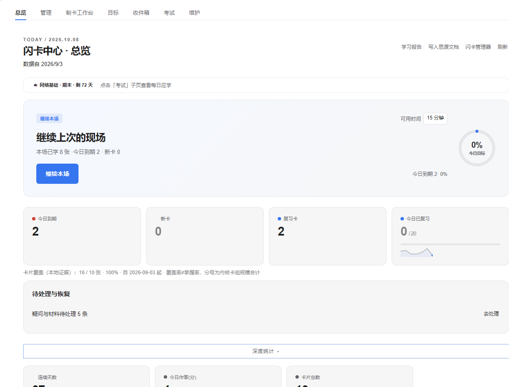
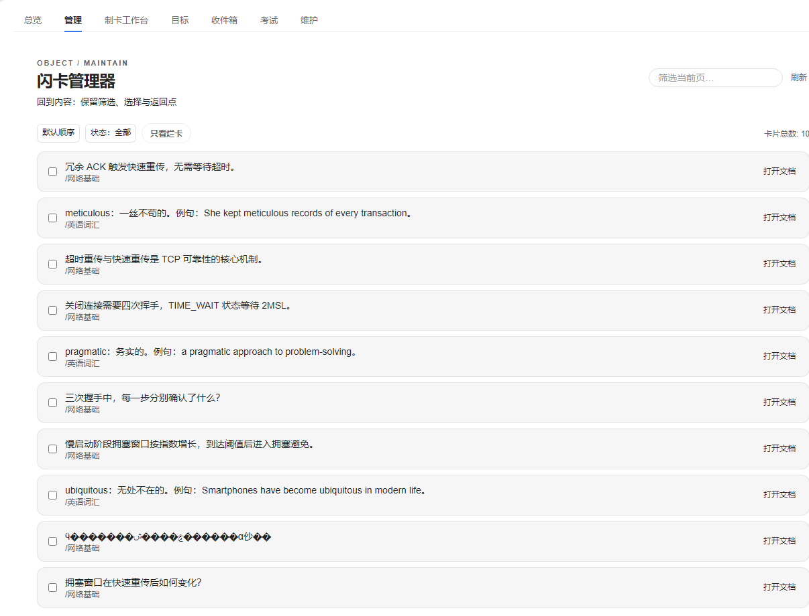
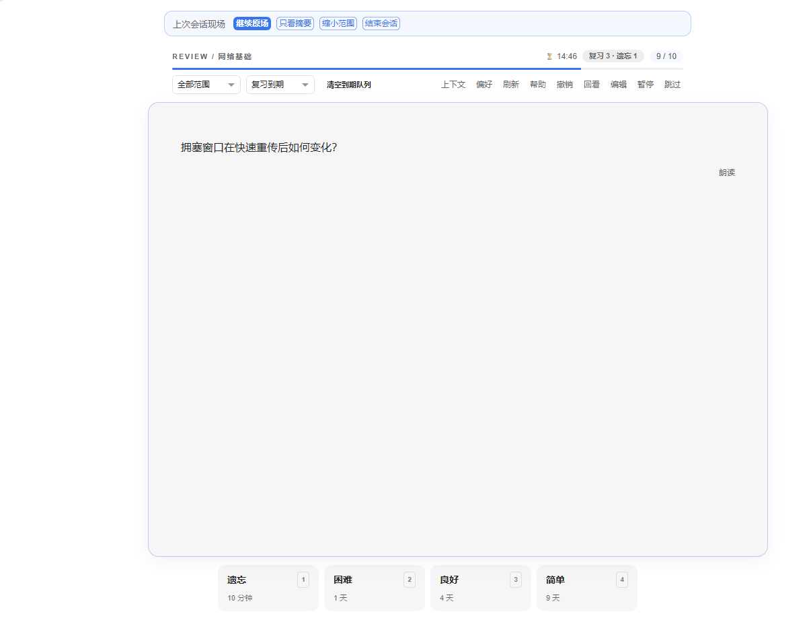

# Lv Cards (Beta) · 小驴闪卡（内测版）

**Turn your notes into long-term knowledge you can actually use.**

The full-lifecycle flashcard learning platform for SiYuan — local-first, native FSRS scheduling, auditable AI assistance

中文 ｜ [English](./README.en.md)

> **Note**: The primary README and all design docs are in Chinese. This page covers the essentials; see [docs/](./docs/README.md) for full design material.

Lv Cards turns blocks worth remembering into traceable flashcards, scheduled by SiYuan's native FSRS algorithm with optional, auditable AI assistance. The current version is **v0.210.75** (2026-10-26), delivering responsive dual-column shortcut help overlays and Bento vector styling for the Recovery Center. See [GitHub Release](https://github.com/ai68298100/siyuan-lv-cards/releases/tag/v0.210.75) for the package and publishing status.

## What's New in v0.210.75

- **Responsive Dual-Column Shortcut Help Overlay**:
  - Upgraded the shortcut help overlay (`?`) with a 2-column responsive grid, eliminating vertical scrolling across 16+ shortcut guides.
  - Added self-referencing `?` toggle documentation and refined tactile keyboard badge styles.
- **Bento Vector Styling for Recovery Center**:
  - Standardized action buttons (AI Job Resume, Open Inbox, Open Maintenance) with monochromatic vector icons and rounded Bento pills.
- **Verification**:
  - 1949 tests across 243 test suites 100% passing; 18/18 isolated E2E tests passing; production build and smoke tests green.

## Previous Update: v0.210.74

- **Capture Inbox Live Search & Filter**:
  - Added a search filter bar to the inbox actions header, supporting instant fuzzy filtering of extracted card material by text content and block IDs.
- **Bento Vector Action Bar for Inbox**:
  - Upgraded batch actions (Stage, Select, Dismiss, Make Cards, Undo, Restore, Remove) with monochromatic vector icons and rounded Bento pills (`.lv-btn-tool`).
  - Upgraded row "Open Source" buttons with `<LvIcon name="eye" size={12} />`.
- **Verification**:
  - 1949 tests across 243 test suites 100% passing; 18/18 isolated E2E tests passing; production build and smoke tests green.

## Previous Update: v0.210.73

- **Settings Category Anchor Rail (Sticky Settings Rail)**:
  - Added a horizontal Bento chip rail under the settings search box (Rhythm, Answer, Voice, AI Providers, Import/Export, Backup).
  - Enables smooth scrolling to any target section, eliminating cognitive fatigue across complex configurations.
- **Component Capability**:
  - `LvSection.svelte` now accepts an optional `id` prop for precise layout anchoring.
- **Verification**:
  - 1948 tests across 242 test suites 100% passing; 18/18 isolated E2E tests passing; production build and smoke tests green.

## Previous Update: v0.210.72

- **Split Diff Layout for Card Editor**:
  - Upgraded `card-editor.svelte` with a responsive two-column grid in wide viewports (left for live editing, right for instant diff inspection).
  - Eliminates vertical scrolling between edits and visual changes, while naturally reflowing into vertical stacking on narrow devices.
- **Verification**:
  - 1948 tests across 242 test suites 100% passing; 18/18 isolated E2E tests passing; production build and smoke tests green.

## Previous Update: v0.210.71

- **Zen Mode Floating Action Island**:
  - Upgraded the Zen exit button into a sleek, frosted glass floating pill bar (`.lv-zen-island`).
  - Allows in-place font scale adjustments (`A- / A+`), card starring (`⭐`), and quick memo editing (`💡`) without breaking focus or leaving Zen Mode.
- **Pairing Game Match Pop & Fade Animation**:
  - Matching cards now exhibit an elegant `scale(1.04)` spring pop and smooth fade-out upon successful connection.
- **Verification**:
  - 1948 tests across 242 test suites 100% passing; 18/18 isolated E2E tests passing; production build and smoke tests green.

## Previous Update: v0.210.70

- **Phase S2 Core Interaction Delivery**:
  - Single-choice and judgment quiz options now feature a 100ms answer feedback cadence, providing immediate tactile response before smoothly revealing the explanation.
  - Added a dedicated "Sprint Review" launch button on the Dashboard exam banner.
  - Enhanced Done screen next actions to allow immediate starred card drill even when no cards were skipped or forgotten.
- **Verification**:
  - 1948 tests across 242 test suites 100% passing; 18/18 isolated E2E tests passing; production build and smoke tests green.

## Previous Update: v0.210.69

- **Editor Style Isolation & Focus-Visible Containment**:
  - Identified and fixed an unscoped `:focus-visible { outline: none; box-shadow: var(--lv-focus-ring); }` global rule from legacy stylesheets.
  - Confined all focus-ring and high-contrast border styles strictly within `:is(.lv-page, .lv-hub, .lv-dialog, .lv-peek-body, .lv-review, .lv-aiwiz) :focus-visible`, eliminating any outline leakage onto native document titles or paragraphs.
- **Verification**:
  - 1948 tests across 242 test suites 100% passing; 18/18 isolated E2E tests passing; production build and smoke tests green.

## Previous Update: v0.210.68

- **Full Scheme A Indigo / Amber Palette Deployment**:
  - Replaced legacy red branding with modern Periwinkle Indigo (`#6366F1`, dark `#818CF8`) and warm amber gold (`#F59E0B`), harmonizing with the Lv ecosystem aesthetic.
  - Aligned primary CTA buttons (`+ Manual Card`, `Start Review`) to unified glowing purple gradients, eliminating external teal/green clashes.
  - Restructured deck lists: empty deck buttons now use calm neutral slate borders instead of misleading red alert outlines.
- **Verification**:
  - 1948 tests across 242 test suites 100% passing; 18/18 isolated E2E tests passing; production build and smoke tests green.

> For complete historical release notes, please see [CHANGELOG.md](./CHANGELOG.md).

## 📸 Screenshots

| Overview — pick up where you left off | Review — recall first, check, then grade |
|---|---|
|  |  |
| **Manager** — back to content, with source & history | **Rating bar** — 4-button grading with interval preview |
|  |  |

## ✨ Features

| Module | Highlights |
|---|---|
| 🃏 **Review** | 4/3-button rating with interval preview · source-context preview · hint ladder · forgotten-card batch re-queue · undo · type-in grading (LCS diff) · dictation (TTS) · multiple choice · image occlusion · mixed question-type rotation · timeout mode · session resume |
| ✍️ **Create** | Block cards (multi-select) · cloze from selection · quick Q/A · marker scanning · AI batch generation (12-template prompt registry + provider fallback) · occlusion editor · manual editing with pre-save diff |
| 🧭 **Learning journey** | Material inbox → authoring workbench · learning goals (three-step chain + daily budget) · content lifecycle panel · entry context · wrap-up reasons · recovery banner · next-step suggestions |
| 📊 **Stats & diagnostics** | Heatmap · **study calendar with load forecast** · **deck dashboard** (per-deck due/retention/leech ranking) · streak · retention curve · capability share · error reasons · AI batch quality |
| 🗂 **Manage** | Paged browsing with search & filters · card detail drawer (content/source/learning record/issues — four facets + version tracking) · batch operations · export CSV / Obsidian SR · maintenance debt queue |
| 🎓 **Exam** | Daily targets from deadline · cram mode · post-exam report |
| 📦 **Share & migrate** | Obsidian SR import/export with deck mapping & fingerprint dedup · Anki `.apkg` import when the desktop host provides `node:sqlite` and `node:zlib` · deck-level share pack export · JSON/CSV review log export & import |
| ⌨ **⌘K palette** | Actions + navigation, keyboard-first access to every entry point |
| 📅 **Weekly report** | Auto-write last week's review summary to a SiYuan document (opt-in) |
| 🛡 **AI safety** | Preflight checks · prompt-injection isolation · context budget planner · emergency kill switch |

## 🚀 Install

SiYuan ≥ 3.8.0. Desktop is the core experience; mobile and browser are narrow-screen adapted (390px structural walkthrough recorded), while the full Android SiYuan host matrix remains pending.

1. Download `package.zip` from the [latest release](https://github.com/ai68298100/siyuan-lv-cards/releases/latest) (do **not** unzip)
2. SiYuan → Settings → Marketplace → Download → "Import package" → pick the zip
3. Enable "Lv Cards (Beta)" under Downloaded

## ⌨️ Quick start

1. Select a block → block icon → **Add to deck**
2. Press **Ctrl+K** for the command palette, or click the **donkey badge** in the top bar
3. In review: **Space** flips, **1-4** rates, `?` shows all shortcuts

## 📚 Docs

Full design docs in [docs/](./docs/README.md) (Chinese). The [R54 interactive prototype](./docs/prototypes/lv-cards-r54.html) is the single source of truth for UI structure, visual language, copy, interaction states, and responsive breakpoints; compare implementation evidence in the [R54 acceptance ledger](./docs/45-R54实现对照与验收台账.md) and component APIs in the [component catalogue](./docs/46-组件目录与状态契约.md). [R53 design spec](./docs/42-UI设计规范-R53.md) is retained as a historical reference. See also [product positioning](./docs/41-竞品调研与定位强化.md) · [user guide](./docs/21-用户上手指南.md) · [FAQ](./docs/20-FAQ与故障排查.md) · [privacy](./docs/PRIVACY.md). For development, see [CONTRIBUTING](./CONTRIBUTING.md); report bugs through [Issues](https://github.com/ai68298100/siyuan-lv-cards/issues) and security problems through [SECURITY](./SECURITY.md).

## 🗺 Roadmap

| Priority | Item | Status |
|---|---|---|
| P0 | ⌘K command palette | ✅ v0.206.3 |
| P0 | Learning calendar & load forecast | ✅ v0.206.4 |
| P1 | Weekly report | ✅ v0.206.7 |
| P1 | Deck dashboard | ✅ v0.206.8 |
| P1 | Share pack (deck-level Obsidian SR export) | ✅ v0.206.9 |
| P2 | 390px narrow-screen structural walkthrough | ✅ v0.206.10 |
| P1 | Starline UI overhaul (page heads / complete states / micro-motion / narrow screen / review polish) | ✅ v0.208.0 |
| P2 | Full Android SiYuan host matrix | Pending |
| P2 | Templates & fields | Deferred |

## 🙏 Credits

- Built on [plugin-sample-vite-svelte](https://github.com/siyuan-note/plugin-sample-vite-svelte)
- Scheduling: SiYuan kernel's native [go-fsrs](https://github.com/open-spaced-repetition/go-fsrs)
- Research: Anki, Obsidian Spaced Repetition, RemNote, Mochi, Quizlet, Knowt, and SiYuan community plugins — see [docs/41](./docs/41-竞品调研与定位强化.md)

## License

[MIT](./LICENSE) © ai68298100
