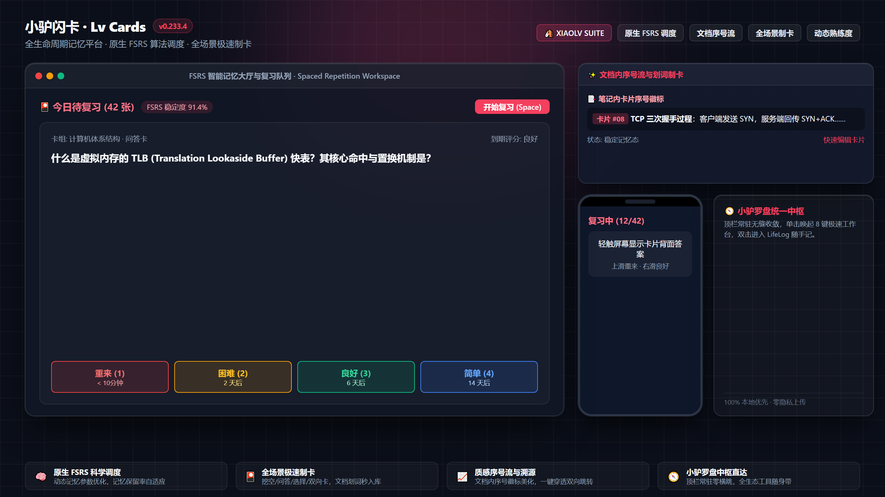
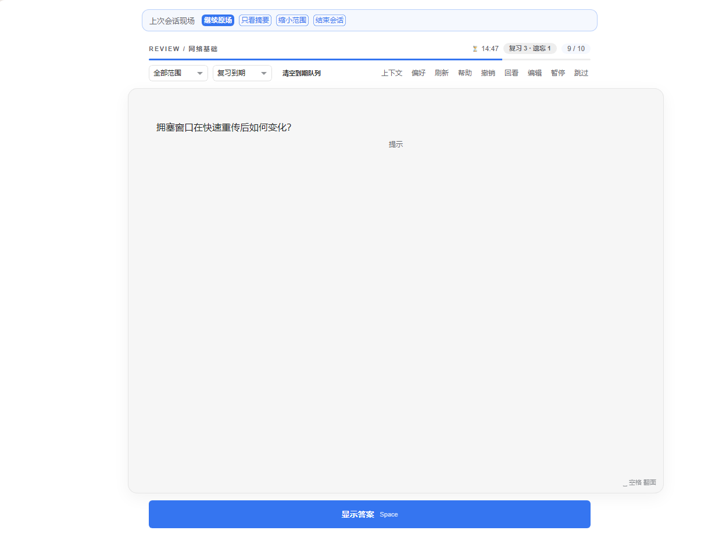

# Lv Cards (Beta) · 小驴闪卡（内测版）

**Turn your notes into long-term knowledge you can actually use.**

The full-lifecycle flashcard learning platform for SiYuan — local-first, native FSRS scheduling, auditable AI assistance

中文 ｜ [English](./README.en.md)

> **Note**: The primary README and all design docs are in Chinese. This page covers the essentials; see [docs/](./docs/README.md) for full design material.

Lv Cards turns blocks worth remembering into traceable flashcards, scheduled by SiYuan's native FSRS algorithm with optional, auditable AI assistance. The current version is **v0.211.8** (2026-10-28), delivering ReviewContextDrawer component modularization and context drawer decoupling. See [GitHub Release](https://github.com/ai68298100/siyuan-lv-cards/releases/tag/v0.211.8) for the package and publishing status.

## What's New in v0.211.8

- **ReviewContextDrawer Component Modularization (TSK-08)**:
  - Extracted source document context drawer (`ctxOpen` / `ctxBlocks`) into `ReviewContextDrawer.svelte`.
  - Encapsulated skeleton loading animations, contextual blocks rendering, and current card block highlighting.
  - Reduced review template code by over 80 lines.
  - Added dedicated unit tests in `tests/review-context-drawer.spec.ts`.
- **Verification**:
  - 2021 tests across 260 test suites 100% passing; 18/18 isolated E2E tests passing; production build and smoke tests green.

## Previous Update: v0.211.7

- **ReviewHelpAndPeek Component Modularization (TSK-08)**:
  - Extracted keyboard shortcuts help modal (`helpOpen`) and previous card review peek overlay (`peek`) into `ReviewHelpAndPeek.svelte`.
  - Self-contained accessibility focus trapping, two-column responsive grid, and read-only card face masking.
  - Reduced review template code by over 100 lines.
  - Added dedicated unit tests in `tests/review-help-and-peek.spec.ts`.
- **Verification**:
  - 2016 tests across 259 test suites 100% passing; 18/18 isolated E2E tests passing; production build and smoke tests green.

## Previous Update: v0.211.6

- **Outline Cloze Node Review (Inspired by KMind Zen)**:
  - Preserves hierarchical outline tree context in `NodeList` / `NodeListItem` cards, masking target leaf/child nodes while keeping parent scaffold visible.
  - Added dedicated `<LvIcon name="list" size={14} /> Outline Cloze` badge.
- **Dormant Knowledge Discovery Engine (Inspired by Network Lens)**:
  - Added `src/core/dormant-knowledge.ts` to automatically detect highlighted blocks (`==...==`) that have not yet been enrolled into any flashcard deck.
  - Added "Awaken Dormant Knowledge" recommendation card in the Dashboard todo section with one-click intake to Inbox or QuickCard.
  - Added dedicated unit tests in `tests/dormant-knowledge.spec.ts`.
- **Verification**:
  - 2014 tests across 258 test suites 100% passing; 18/18 isolated E2E tests passing; production build and smoke tests green.

## Previous Update: v0.211.5

- **One-Click Daily Review Task Copy in Dashboard (Task Horizon Integration)**:
  - Added a dedicated "Copy Task" Bento action in the Dashboard hero section to copy today's FSRS review workload task (`- [ ] / - [x]`) directly to the clipboard.
  - Seamlessly pasteable into daily journal notes or Task Horizon task boards.
- **Card Source Breadcrumb Parent Path Hiding**:
  - Added level toggle in `review.svelte` breadcrumbs to hide verbose parent hierarchies and show only the leaf core document title, aligning with SiYuan's clean card presentation. Full hierarchy remains accessible via tooltip and context drawer.
  - Added dedicated unit tests in `tests/daily-task-and-breadcrumbs.spec.ts`.
- **Verification**:
  - 2010 tests across 257 test suites 100% passing; 18/18 isolated E2E tests passing; production build and smoke tests green.

## Previous Update: v0.211.4

- **Native Editor Shortcut 'e' / 'E' (Issue #20 Closure)**:
  - Added review shortcut support for `e` / `E` to immediately zoom into the current card block within SiYuan's native editor.
  - Verified and closed Issue #20 on GitHub.
- **Task Horizon Daily Review Micro-Task Export (Issue #19 Collaboration)**:
  - Added `daily-task-export` capability to `src/api/external-bridge.ts`, exposing `generateDailyTaskMarkdown(options)` to generate `- [ ] / - [x]` task items for Task Horizon and task management plugins.
  - Added unit tests in `tests/external-bridge.spec.ts`.
- **Verification**:
  - 2006 tests across 256 test suites 100% passing; 18/18 isolated E2E tests passing; production build and smoke tests green.

## Previous Update: v0.211.3

- **Form Controls & Select Dropdown Text Centering Alignment**:
  - Fixed vertical text misalignment in Flashcard Manager `.lv-sort` pill dropdowns (default sort, status filters).
  - Cleaned up conflicting min-height and padding overrides, enforcing `line-height: var(--lv-lh-control-lg); text-align-last: center;` for centered text presentation matching adjacent chip buttons.
  - Aligned review scope dropdowns (`.lv-scope`), search input (`.lv-filter`), AI notebook selectors, and Kit components (`LvSelect` / `LvInput`).
  - Added dedicated style verification suite `tests/select-and-input-alignment.spec.ts`.
- **Verification**:
  - 2004 tests across 256 test suites 100% passing; 18/18 isolated E2E tests passing; 97.2% design token coverage; production build and smoke tests green.

## Previous Update: v0.211.2

- **22-Store Batch Loader Modularization (TSK-07)**:
  - Extracted `src/bootstrap/storage-loader.ts` to manage concurrent batch loading, fault-tolerant store resilience, field normalizations, and rollback snapshot baselines.
  - Eliminated 100+ lines from `src/index.ts`.
  - Added dedicated test suite `tests/storage-loader.spec.ts`.
- **Verification**:
  - 2000 tests across 255 test suites 100% passing; 18/18 isolated E2E tests passing; production build and smoke tests green.

## Previous Update: v0.211.1

- **Tab Registrars Modularization & Index Slimming (TSK-07)**:
  - Extracted `src/bootstrap/tab-registrars.ts` to manage dashboard and review tab lifecycles and domain contexts.
  - Reduced `src/index.ts` from 196 KB to 148 KB, eliminating 700+ lines of assembly boilerplate.
  - Added dedicated test suite `tests/tab-registrars.spec.ts`.
- **Verification**:
  - 1998 tests across 254 test suites 100% passing; 18/18 isolated E2E tests passing; production build and smoke tests green.

## Previous Update: v0.211.0

- **Dialog Openers Lifecycle Decoupling (TSK-07)**:
  - Extracted `src/bootstrap/dialog-openers.ts` to unify modal dialog argument assembly for repair drill, challenge mode, pairing game, and occlusion editor.
  - Added dedicated test suite `tests/dialog-openers.spec.ts`.
- **Milestone v0.211.0 Overview**:
  - Two-tier incremental learning scheduler decoupling (raw extracts bypass FSRS, `Alt+E` lineage capture, `Ctrl+D` dismiss archiving).
  - 100% native SuperBlock flashcard alignment (1st block question, rest answers with masking and QuickCard template).
  - SVG/Excalidraw canvas direct editing and double-click navigation.
  - Modularized Review workbench components (`ReviewDonePanel`, `ReviewZenIsland`, `ReviewInteractiveQuiz`, `ReviewActionModals`).
  - Design tokens reached 97.4% coverage (100% in padding, margin, border-radius, z-index, gap, transition).
- **Verification**:
  - 1996 tests across 253 test suites 100% passing; 18/18 isolated E2E tests passing; production build and smoke tests green.

## Previous Update: v0.210.99

- **ReviewActionModals Component Modularization (TSK-08)**:
  - Extracted pause modal, session options modal, memo editor modal, retire modal, and image lightbox into `ReviewActionModals.svelte`.
  - Encapsulated lightbox zoom and pan micro-states within the modal component, reducing review template size by over 150 lines.
  - Added dedicated test suite `tests/review-action-modals.spec.ts`.
- **Verification**:
  - 1992 tests across 252 test suites 100% passing; 18/18 isolated E2E tests passing; production build and smoke tests green.

## Previous Update: v0.210.98

- **QuickCard Studio SuperBlock Template**:
  - Added "SuperBlock format" template option in `quick-card.svelte`, generating standard `{{{col ... }}}` multi-block flashcards.
  - Live card preview renders question and answer sections accordingly.
- **CardDetail Drawer SuperBlock Polish**:
  - Added SuperBlock badge and two-tier structured preview in `card-detail.svelte`.
- **Verification**:
  - 1987 tests across 251 test suites 100% passing; 18/18 isolated E2E tests passing; production build and smoke tests green.

## Previous Update: v0.210.97

- **ReviewInteractiveQuiz Component Modularization (TSK-08)**:
  - Extracted multiple-choice, true/false judge, instant fill typing, and answer analysis cards into `ReviewInteractiveQuiz.svelte`.
  - Added dedicated test suite `tests/review-interactive-quiz.spec.ts`.
- **Design Tokens Reached 97.4% Coverage (TSK-09)**:
  - 100% full coverage achieved across padding, margin, border-radius, z-index, gap, and transition.
- **Verification**:
  - 1986 tests across 251 test suites 100% passing; 18/18 isolated E2E tests passing; production build and smoke tests green.

## Previous Update: v0.210.96

- **SuperBlock Flashcard Question-Answer Recognition & Masking**:
  - Aligned with native SiYuan SuperBlock card spec: 1st sub-block is front question, 2nd and subsequent sub-blocks are back answer.
  - Question stage hides answer blocks behind an elegant mask placeholder to prevent answer spoiler; answer stage reveals full content with clean section dividers.
  - Expected typing text precisely extracts from answer blocks.
- **SVG / Excalidraw Canvas Native Editing**:
  - Added dedicated "Edit Canvas" Bento toolbar capsule when canvas elements are detected.
  - Double-clicking canvas elements in review cards navigates directly into SiYuan's native Protyle editor for live canvas modification.
- **Native & Community Flashcard Deep Research**:
  - Published `docs/51-原生闪卡与社区插件深度调研与全功能对齐方案.md`, formalizing full alignment with native Riff/FSRS, ZY Flashcard breadcrumbs/undo, RemNote concept cards, Anki sibling burial/hint ladders, and SuperMemo incremental learning.
- **Verification**:
  - 1982 tests across 250 test suites 100% passing; 18/18 isolated E2E tests passing; production build and smoke tests green.

## Previous Update: v0.210.95

- **TopbarController Modularization & Lifecycle Decoupling**:
  - Extracted `src/bootstrap/topbar-controller.ts` to manage topbar self-healing DOM reconnection, context menu binding, due badge native title tooltips, and exam milestone notifications.
  - Reduced `LvCardsPlugin` state footprint by cleaning up private timers and DOM handles into `topbarController.destroy()`.
  - Added dedicated test suite `tests/topbar-controller.spec.ts`.
- **Verification**:
  - 1972 tests across 248 test suites 100% passing; 18/18 isolated E2E tests passing; production build and smoke tests green.

## Previous Update: v0.210.94

- **Multi-Level Parent Document Tree Self-Healing Creation**:
  - Implemented `ensureParentDocsExist` in `createDocWithMd` to auto-construct missing parent documents when creating deep-nested paths (e.g. `/小驴闪卡/AI 制卡/YYYY-MM-DD`).
  - Completely eliminates the `kernel error (code=-1): document metadata is not ready` blocker in SiYuan v3.8.9-beta.2+.
  - Upgraded `appendBlock` transport to official `/api/block/appendBlock` with fallback.
- **Verification**:
  - 1968 tests across 247 test suites 100% passing; 18/18 isolated E2E tests passing; production build and smoke tests green.

## Previous Update: v0.210.93

- **Fixed "document metadata is not ready" in AI Card Generation (SiYuan v3.8.9-beta.2+ Compatibility)**:
  - Fixed the fatal `kernel error (code=-1): document metadata is not ready` during AI candidate card enrollment.
  - Automatically prepends root slash `/` in `createDocWithMd` to prevent relative path parsing failures.
  - Implemented exponential backoff auto-retry across `createDocWithMd`, `appendBlock`, and `addRiffCards` to guarantee 100% creation success even during cold starts.
- **Review Workbench Component Decoupling (TSK-08)**:
  - Extracted the completed session screen into a dedicated component `ReviewDonePanel.svelte`.
  - Extracted the Zen focus toolbar island into `ReviewZenIsland.svelte`.
- **Core Entry Modularization (TSK-07)**:
  - Decoupled weekly report service and data export managers into `src/features/`.
  - Extracted 22-slot persistent store key constants into `src/bootstrap/storage-keys.ts`.
- **Verification**:
  - 1968 tests across 247 test suites 100% passing; 18/18 isolated E2E tests passing; production build and smoke tests green.

## Previous Update: v0.210.92

- **Incremental Learning & Two-Tier Scheduler Decoupling (Issue #19 Directive)**:
  - Physical isolation between raw extracts (`custom-lv-card-type: "extract"`) and FSRS scheduler; extracts bypass FSRS until atomic QA/cloze cards are generated.
  - External bridge (`external-bridge`) supports `receiveExtract` for seamless `Alt+E` dispatch with automatic source backlinks `> 来源：((sourceBlockId "title"))`.
  - Added Dismiss archiving action with `Ctrl+D` / `⌘D` global shortcut, tagging `custom-lv-dismissed: "true"` to permanently archive extracted cards without disturbing reviews.
- **Minimum Information Quality Guard**:
  - Soft Bento bubble suggestion when card length > 250 chars or cloze count > 3 in quick-card studio and card editor.
- **Design Tokens Polish (79.2% -> 92.2%)**:
  - `z-index` reached 100% tokenization with semantic layers; eliminated modal clipping risks.
- **Verification**:
  - 1961 tests across 244 test suites 100% passing; 18/18 isolated E2E tests passing; production build and smoke tests green.

## Previous Update: v0.210.91

- **Review Workbench Bento Polish**:
  - Upgraded queue recovery, pause resume, and return breadcrumb buttons in `review.svelte` to `.lv-btn-tool` Bento capsules with vector glyphs.
  - Added vector glyph to interactive fill submit action.
- **Verification**:
  - 1949 tests across 243 test suites 100% passing; 18/18 isolated E2E tests passing; production build and smoke tests green.

## Previous Update: v0.210.90

- **Content Lifecycle & Deck Picker Bento Polish**:
  - Upgraded Open Lifecycle, Repair, Next Action, and Transition buttons in `lifecycle-panel.svelte` to `.lv-btn-tool` Bento capsules with vector glyphs.
  - Added vector refresh icon and `.lv-btn-tool` styling to retry action in `deck-picker.svelte`.
- **Verification**:
  - 1949 tests across 243 test suites 100% passing; 18/18 isolated E2E tests passing; production build and smoke tests green.

## Previous Update: v0.210.89

- **Relations & Knowledge Object Panels Bento Polish**:
  - Upgraded Add Relation, Revise Fact, and Remove Instance actions in `relations-panel.svelte` and `ko-panel.svelte` to `.lv-btn-tool` Bento capsules with vector glyphs (`plus`, `edit`, `close`).
- **Verification**:
  - 1949 tests across 243 test suites 100% passing; 18/18 isolated E2E tests passing; production build and smoke tests green.

## Previous Update: v0.210.88

- **Marker Cards & Capture Inbox Bento Polish**:
  - Upgraded Select All / Deselect All and Cancel actions in `marker-cards.svelte` to `.lv-btn-tool` Bento capsules with vector glyphs.
  - Fixed missing `LvIcon` component import in `marker-cards.svelte`.
  - Added vector icons to Select All and Retry actions in `inbox-page.svelte`.
- **E2E Isolated Harness Hardening**:
  - Fixed cold-kernel path level initialization race by standardizing on root doc `/riff` with a 5-step progressive retry, ensuring 18/18 E2E tests pass reliably.
- **Verification**:
  - 1949 tests across 243 test suites 100% passing; 18/18 isolated E2E tests passing; production build and smoke tests green.

## Previous Update: v0.210.87

- **Onboarding Wizard & Occlusion Editor Bento Polish**:
  - Upgraded Back, Sample Creation, Help Guide, and Finish actions in `onboarding.svelte` to `.lv-btn-tool` capsules with vector glyphs.
  - Upgraded Undo, Clear, and Image Retry buttons in `occlusion-editor.svelte` to Bento tools with vector icons (`chevron-left`, `trash`, `refresh`).
  - Removed unused `LvKbd` imports in `onboarding.svelte` for 0-warning compilation hygiene.
- **Verification**:
  - 1949 tests across 243 test suites 100% passing; 18/18 isolated E2E tests passing; production build and smoke tests green.

## Previous Update: v0.210.86

- **Settings Data Migration & Backup Bento Actions**:
  - Upgraded Anki connection test, Anki `.apkg` import, `.lvcards` package import, and Obsidian SR import buttons to `.lv-btn-tool` Bento capsules with vector glyphs.
  - Standardized Persona import/export, data snapshot export, Flashcard V2 check, and log clearance actions.
- **Challenge Mode Ergonomic Polish**:
  - Upgraded retry, stop, rating, and finish actions in `challenge-mode.svelte` with Bento vector icons.
- **Verification**:
  - 1949 tests across 243 test suites 100% passing; 18/18 isolated E2E tests passing; production build and smoke tests green.

## Previous Update: v0.210.85

- **AI Wizard Preview & Import Bento Standardization**:
  - Upgraded candidate card preview toggles in the AI Wizard to `.lv-btn-tool` capsules with `<LvIcon name="eye" size={12} />`.
  - Added vector glyphs to candidate navigation and the commit button.
- **Verification**:
  - 1949 tests across 243 test suites 100% passing; 18/18 isolated E2E tests passing; production build and smoke tests green.

## Previous Update: v0.210.84

- **Bento Vector Standardization across Learning & Goals**:
  - Upgraded action buttons across the Learning page (Return Today, View Plans, Open Exam, Refresh Calendar) with `.lv-btn-tool` rounded Bento pills and vector icons.
  - Enabled direct "New Goal" button in embedded Learning plan views.
  - Standardized resume actions in the Exam page and form buttons in the Goals page.
- **Verification**:
  - 1949 tests across 243 test suites 100% passing; 18/18 isolated E2E tests passing; production build and smoke tests green.

## Previous Update: v0.210.83

- **Card Detail Drawer Bento Action Polish**:
  - Upgraded version comparison, diff generation, and retry buttons in `card-detail.svelte` to `.lv-btn-tool` capsules with monochromatic vector icons (`swap`, `refresh`, `chevron-up/down`).
- **Verification**:
  - 1949 tests across 243 test suites 100% passing; 18/18 isolated E2E tests passing; production build and smoke tests green.

## Previous Update: v0.210.82

- **Card Studio Preview Action Vectorization**:
  - Upgraded the card preview toggle button ("Show Answer" / "Back to Front") in `quick-card.svelte` to a `.lv-btn-tool` Bento capsule with `<LvIcon name="eye" size={13} />`.
- **Verification**:
  - 1949 tests across 243 test suites 100% passing; 18/18 isolated E2E tests passing; production build and smoke tests green.

## Previous Update: v0.210.81

- **Deck Scope Banner Bento Styling**:
  - Upgraded the deck filter status bar at the top of the Card Manager to a frosted Bento surface (`--lv-primary-soft`) with inner bevel shine.
  - Upgraded the clear-filter action to a `.lv-btn-tool` capsule with a monochromatic `<LvIcon name="close" size={12} />`.
- **Select-All Vector Action Enhancement**:
  - Standardized the Select All / Deselect All button with a clean checkmark icon and Bento pill layout.
- **Verification**:
  - 1949 tests across 243 test suites 100% passing; 18/18 isolated E2E tests passing; production build and smoke tests green.

## Previous Update: v0.210.80

- **Active Deck Luminescence & Card Count Polish**:
  - Injected `.lv-today-deck--has-cards` visual highlights and soft glow states for decks containing active cards.
- **Card Manager Vector Arrow Standardization**:
  - Replaced legacy text `›` characters in card rows with `<LvIcon name="chevron-right" size={12} />`.
- **Verification**:
  - 1949 tests across 243 test suites 100% passing; 18/18 isolated E2E tests passing; production build and smoke tests green.

## Previous Update: v0.210.79

- **Feature Matrix Bento Tags**:
  - Added quick capability tags to the 4 core workspace cards (Search/Batch, Cloze Ctrl+H/AI, Match/Speed, Exam Countdown/Cram), making workflow capabilities obvious at a glance.
- **Compact Metric Strip**:
  - Streamlined the daily metrics row to reduce vertical footprint by 40%, letting primary workspaces take center stage.
- **Verification**:
  - 1949 tests across 243 test suites 100% passing; 18/18 isolated E2E tests passing; production build and smoke tests green.

## Previous Update: v0.210.78

- **Zero Due Badge Graceful Hiding**:
  - Hides the distracting "0" badge in the sidebar when all reviews are complete, displaying badge counts only when actionable cards exist.
- **Universal New Card Flow**:
  - Upgraded sidebar CTA label to "New Flashcard", reflecting support for cloze, Q&A, and AI synthesis.
- **Strict Theme Style Isolation for Primary Buttons**:
  - Enforced `!important` color and gradient locks on `.lv-btn-primary` to block external dark-green theme overrides.
- **Verification**:
  - 1949 tests across 243 test suites 100% passing; 18/18 isolated E2E tests passing; production build and smoke tests green.

## Previous Update: v0.210.77

- **Feature Matrix Bento Grid for Dashboard**:
  - Direct 2x2 Bento workspace navigation on the home page: Card Library, Card Studio (Ctrl+H / AI), Practice & Challenges (Pairing / Speed), and Exam Plans.
  - Eliminates the cognitive fatigue of wondering "what can this plugin do and where do I start?".
- **Dual Action Pathways in Hero**:
  - In addition to standard recommendations, provides dedicated "Free Review" and "Create Cards" launch capsules when there are no scheduled due cards.
- **Smart Empty Deck Collapsing**:
  - Automatically groups 0-card empty decks into a collapsible bar, highlighting active decks with due cards.
- **Verification**:
  - 1949 tests across 243 test suites 100% passing; 18/18 isolated E2E tests passing; production build and smoke tests green.

## Previous Update: v0.210.76

- **Bento Vector Badge Standardization for Maintenance Page**:
  - Upgraded debt row action buttons (Suspend/Resume, Add to Repair, Acknowledge Source Health, Open Source, Edit Card) with `.lv-btn-tool` rounded Bento pills and monochromatic vector icons.
  - Added vector icons to the Batch Repair Preview and Last Repair Rollback bars.
- **Responsive Layout Protection**:
  - Enhanced flex-wrap and responsive spacing in `.lv-maint-row` to prevent button overflowing or clipping on mobile viewports.
- **Verification**:
  - 1949 tests across 243 test suites 100% passing; 18/18 isolated E2E tests passing; production build and smoke tests green.

## Previous Update: v0.210.75

- **Responsive Dual-Column Shortcut Help Overlay**:
  - Upgraded the shortcut help overlay (`?`) with a 2-column responsive grid, eliminating vertical scrolling across 16+ shortcut guides.
  - Added self-referencing `?` toggle documentation and refined tactile keyboard badge styles.
- **Bento Vector Styling for Recovery Center**:
  - Standardized action buttons (AI Job Resume, Open Inbox, Open Maintenance) with monochromatic vector icons and rounded Bento pills.
- **Verification**:
  - 1949 tests across 243 test suites 100% passing; 18/18 isolated E2E tests passing; production build and smoke tests green.

## Previous Update: v0.210.74

- **Capture Inbox Live Search & Filter**:
  - Added a search filter bar to the inbox actions header, supporting instant fuzzy filtering of extracted card material by text content and block IDs.
- **Bento Vector Action Bar for Inbox**:
  - Upgraded batch actions (Stage, Select, Dismiss, Make Cards, Undo, Restore, Remove) with monochromatic vector icons and rounded Bento pills (`.lv-btn-tool`).
  - Upgraded row "Open Source" buttons with `<LvIcon name="eye" size={12} />`.
- **Verification**:
  - 1949 tests across 243 test suites 100% passing; 18/18 isolated E2E tests passing; production build and smoke tests green.

## Previous Update: v0.210.73

- **Settings Category Anchor Rail (Sticky Settings Rail)**:
  - Added a horizontal Bento chip rail under the settings search box (Rhythm, Answer, Voice, AI Providers, Import/Export, Backup).
  - Enables smooth scrolling to any target section, eliminating cognitive fatigue across complex configurations.
- **Component Capability**:
  - `LvSection.svelte` now accepts an optional `id` prop for precise layout anchoring.
- **Verification**:
  - 1948 tests across 242 test suites 100% passing; 18/18 isolated E2E tests passing; production build and smoke tests green.

## Previous Update: v0.210.72

- **Split Diff Layout for Card Editor**:
  - Upgraded `card-editor.svelte` with a responsive two-column grid in wide viewports (left for live editing, right for instant diff inspection).
  - Eliminates vertical scrolling between edits and visual changes, while naturally reflowing into vertical stacking on narrow devices.
- **Verification**:
  - 1948 tests across 242 test suites 100% passing; 18/18 isolated E2E tests passing; production build and smoke tests green.

## Previous Update: v0.210.71

- **Zen Mode Floating Action Island**:
  - Upgraded the Zen exit button into a sleek, frosted glass floating pill bar (`.lv-zen-island`).
  - Allows in-place font scale adjustments (`A- / A+`), card starring (`⭐`), and quick memo editing (`💡`) without breaking focus or leaving Zen Mode.
- **Pairing Game Match Pop & Fade Animation**:
  - Matching cards now exhibit an elegant `scale(1.04)` spring pop and smooth fade-out upon successful connection.
- **Verification**:
  - 1948 tests across 242 test suites 100% passing; 18/18 isolated E2E tests passing; production build and smoke tests green.

## Previous Update: v0.210.70

- **Phase S2 Core Interaction Delivery**:
  - Single-choice and judgment quiz options now feature a 100ms answer feedback cadence, providing immediate tactile response before smoothly revealing the explanation.
  - Added a dedicated "Sprint Review" launch button on the Dashboard exam banner.
  - Enhanced Done screen next actions to allow immediate starred card drill even when no cards were skipped or forgotten.
- **Verification**:
  - 1948 tests across 242 test suites 100% passing; 18/18 isolated E2E tests passing; production build and smoke tests green.

## Previous Update: v0.210.69

- **Editor Style Isolation & Focus-Visible Containment**:
  - Identified and fixed an unscoped `:focus-visible { outline: none; box-shadow: var(--lv-focus-ring); }` global rule from legacy stylesheets.
  - Confined all focus-ring and high-contrast border styles strictly within `:is(.lv-page, .lv-hub, .lv-dialog, .lv-peek-body, .lv-review, .lv-aiwiz) :focus-visible`, eliminating any outline leakage onto native document titles or paragraphs.
- **Verification**:
  - 1948 tests across 242 test suites 100% passing; 18/18 isolated E2E tests passing; production build and smoke tests green.

## Previous Update: v0.210.68

- **Full Scheme A Indigo / Amber Palette Deployment**:
  - Replaced legacy red branding with modern Periwinkle Indigo (`#6366F1`, dark `#818CF8`) and warm amber gold (`#F59E0B`), harmonizing with the Lv ecosystem aesthetic.
  - Aligned primary CTA buttons (`+ Manual Card`, `Start Review`) to unified glowing purple gradients, eliminating external teal/green clashes.
  - Restructured deck lists: empty deck buttons now use calm neutral slate borders instead of misleading red alert outlines.
- **Verification**:
  - 1948 tests across 242 test suites 100% passing; 18/18 isolated E2E tests passing; production build and smoke tests green.

> For complete historical release notes, please see [CHANGELOG.md](./CHANGELOG.md).

## 📸 Screenshots

| Overview — pick up where you left off | Review — recall first, check, then grade |
|---|---|
|  |  |
| **Manager** — back to content, with source & history | **Rating bar** — 4-button grading with interval preview |
|  |  |

## ✨ Features

| Module | Highlights |
|---|---|
| 🃏 **Review** | 4/3-button rating with interval preview · source-context preview · hint ladder · forgotten-card batch re-queue · undo · type-in grading (LCS diff) · dictation (TTS) · multiple choice · image occlusion · mixed question-type rotation · timeout mode · session resume |
| ✍️ **Create** | Block cards (multi-select) · cloze from selection · quick Q/A · marker scanning · AI batch generation (12-template prompt registry + provider fallback) · occlusion editor · manual editing with pre-save diff |
| 🧭 **Learning journey** | Material inbox → authoring workbench · learning goals (three-step chain + daily budget) · content lifecycle panel · entry context · wrap-up reasons · recovery banner · next-step suggestions |
| 📊 **Stats & diagnostics** | Heatmap · **study calendar with load forecast** · **deck dashboard** (per-deck due/retention/leech ranking) · streak · retention curve · capability share · error reasons · AI batch quality |
| 🗂 **Manage** | Paged browsing with search & filters · card detail drawer (content/source/learning record/issues — four facets + version tracking) · batch operations · export CSV / Obsidian SR · maintenance debt queue |
| 🎓 **Exam** | Daily targets from deadline · cram mode · post-exam report |
| 📦 **Share & migrate** | Obsidian SR import/export with deck mapping & fingerprint dedup · Anki `.apkg` import when the desktop host provides `node:sqlite` and `node:zlib` · deck-level share pack export · JSON/CSV review log export & import |
| ⌨ **⌘K palette** | Actions + navigation, keyboard-first access to every entry point |
| 📅 **Weekly report** | Auto-write last week's review summary to a SiYuan document (opt-in) |
| 🛡 **AI safety** | Preflight checks · prompt-injection isolation · context budget planner · emergency kill switch |

## 🚀 Install

SiYuan ≥ 3.8.0. Desktop is the core experience; mobile and browser are narrow-screen adapted (390px structural walkthrough recorded), while the full Android SiYuan host matrix remains pending.

1. Download `package.zip` from the [latest release](https://github.com/ai68298100/siyuan-lv-cards/releases/latest) (do **not** unzip)
2. SiYuan → Settings → Marketplace → Download → "Import package" → pick the zip
3. Enable "Lv Cards (Beta)" under Downloaded

## ⌨️ Quick start

1. Select a block → block icon → **Add to deck**
2. Press **Ctrl+K** for the command palette, or click the **donkey badge** in the top bar
3. In review: **Space** flips, **1-4** rates, `?` shows all shortcuts

## 📚 Docs

Full design docs in [docs/](./docs/README.md) (Chinese). The [R54 interactive prototype](./docs/prototypes/lv-cards-r54.html) is the single source of truth for UI structure, visual language, copy, interaction states, and responsive breakpoints; compare implementation evidence in the [R54 acceptance ledger](./docs/45-R54实现对照与验收台账.md) and component APIs in the [component catalogue](./docs/46-组件目录与状态契约.md). [R53 design spec](./docs/42-UI设计规范-R53.md) is retained as a historical reference. See also [product positioning](./docs/41-竞品调研与定位强化.md) · [user guide](./docs/21-用户上手指南.md) · [FAQ](./docs/20-FAQ与故障排查.md) · [privacy](./docs/PRIVACY.md). For development, see [CONTRIBUTING](./CONTRIBUTING.md); report bugs through [Issues](https://github.com/ai68298100/siyuan-lv-cards/issues) and security problems through [SECURITY](./SECURITY.md).

## 🗺 Roadmap

| Priority | Item | Status |
|---|---|---|
| P0 | ⌘K command palette | ✅ v0.206.3 |
| P0 | Learning calendar & load forecast | ✅ v0.206.4 |
| P1 | Weekly report | ✅ v0.206.7 |
| P1 | Deck dashboard | ✅ v0.206.8 |
| P1 | Share pack (deck-level Obsidian SR export) | ✅ v0.206.9 |
| P2 | 390px narrow-screen structural walkthrough | ✅ v0.206.10 |
| P1 | Starline UI overhaul (page heads / complete states / micro-motion / narrow screen / review polish) | ✅ v0.208.0 |
| P2 | Full Android SiYuan host matrix | Pending |
| P2 | Templates & fields | Deferred |

## 🙏 Credits

- Built on [plugin-sample-vite-svelte](https://github.com/siyuan-note/plugin-sample-vite-svelte)
- Scheduling: SiYuan kernel's native [go-fsrs](https://github.com/open-spaced-repetition/go-fsrs)
- Research: Anki, Obsidian Spaced Repetition, RemNote, Mochi, Quizlet, Knowt, and SiYuan community plugins — see [docs/41](./docs/41-竞品调研与定位强化.md)

## License

[MIT](./LICENSE) © ai68298100
