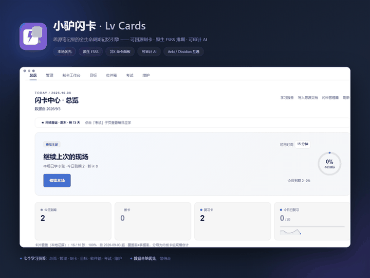

<div align="center">


# 小驴闪卡 · Lv Cards

**思源笔记全生命周期本地优先记忆引擎与学习工作台**

让思源笔记成为记得住、用得上、找得到、改得动、负担得起、带得走的长期知识资产

**当前版本：v0.233.2** ｜ [English Documentation](README.en.md) ｜ [更新日志](CHANGELOG.md)

[](https://github.com/xiaolv-suite/siyuan-lv-cards/releases)
[](https://b3log.org/siyuan)
[](https://github.com/open-spaced-repetition/fsrs4anki)
[](./LICENSE)

[⬇️ 下载安装](#-安装方式) · [🚀 快速上手](#-极速上手3-步跑通第一个场景) · [🖥️ 面板指南](#-各核心工作页面与面板用途) · [⚙️ 设置参考](#-设置项详细说明含默认值与影响) · [⌨️ 快捷键](#-快捷键速查表) · [🔒 隐私承诺](#-数据存放位置与隐私说明)

<br/>



</div>

---

## 🎯 为什么需要小驴闪卡？它解决什么问题？

小驴闪卡（siyuan-lv-cards）旨在彻底解决知识学习者长期面临的**“笔记记了就忘、卡片制了不背、复习积压如山挫败弃坑”**三大核心痛点。插件以思源笔记内核原生的 **FSRS 科学间隔重复算法**为单一事实源，向上贯穿“从阅读材料捕获、原子化制卡、多感官主动回忆自测，到疑难卡熔断治理与跨平台无损迁移”的完整知识内化全闭环：

| 痛点场景 | 传统外部闪卡 App / 原生简易制卡局限 | 小驴闪卡解决方案 |
| :--- | :--- | :--- |
| **记了就忘，脱离语境** | 闪卡割裂于笔记之外，复习时只记得孤立字句，想不起当时在什么上下文下记的 | **块级双向溯源 + 语境抽屉**：每张卡片直通思源底层段落块（`block_id`），复习时按 `C` 键秒级滑出原笔记前后文抽屉 |
| **大段抄录，卡片不可学** | 把一整段教材全塞进卡片，翻面如读天书，越背越抗拒、挫败感极强 | **入组前可学性把关与一键拆卡**：自动拦截过长内容、指代不明、答案剧透，支持将一段文字一键自动拆解为多张原子卡 |
| **复习积压，水蛭卡死循环** | 几十张顽固遗忘的“坏卡”天天弹窗，耗尽每日意志力，导致全盘放弃复习 | **科学 FSRS + 水蛭卡熔断**：内核级 FSRS 拟合曲线；达阈值自动熔断并提示重构；提供 4 级阶梯线索与当场内循环巩固 |
| **笔记修改后卡片断链腐烂** | 原笔记修改或删改后，外部闪卡依然显示旧内容甚至死链，两边脱节 | **带版本留痕的修卡闭环**：指纹监测原块变动，并排呈现“基线原文 vs 当前修改”，一键同步更新并支持历史版本快照回滚 |

---

## ✨ 核心功能清单

### 1. 深度笔记制卡与双向语境回源
- **块级原生双向回源**：闪卡与思源底层笔记块（`block_id`）强绑定，卡面顶部常驻层级面包屑导航，复习中随时一键跳转原笔记查看整篇文档。
- **上下文滑出抽屉（Context Drawer）**：复习卡壳或存疑时，快捷键 `C` 向下滑出该卡片所在文档的前后 2 块完整上下文语境，无需跳出复习切走页面，呵护专注心流。
- **高亮划词与大纲树挖空**：选中文本按下 `==` 自动生成挖空卡；支持多级嵌套大纲挖空与多空按序揭晓。
- **超级块结构化问答**：首块作为题干，后续子块作为多要点答案；在问题态下进行物理级安全遮蔽，彻底杜绝翻面前瞥见答案的剧透漏洞。
- **助记便签（Memo）双向回写**：复习中录入的助记线索或解题心得，实时双向保存并同步回写至思源块备注，越学笔记越丰满。

### 2. 科学抗遗忘复习与多模态交互测验
- **思源内核原生 FSRS 算法驱动**：摒弃传统 SM-2 的粗糙固定乘数，基于遗忘临界点精准拟合记忆保持曲线，评分按钮下方实时预测未来复习间隔。
- **4 级阶梯式提示支架（Hint Ladder）**：遇到卡壳时按快捷键 `h` 阶梯式揭示：回忆目标 → 核心关键词 → 上下文线索 → 最终答案，终结非黑即白的挫败感。
- **遗忘卡当场内循环（Requeue）**：当场评为遗忘（Again）的卡片自动在数分钟后的同场会话中重新出题巩固，杜绝遗忘卡直接滚入明日滚雪球变成积压债务。
- **LCS 动态规划打字默写比对**：支持键盘输入拼写，采用最长公共子序列算法实现字符级色彩高亮比对，专治专业术语“眼熟但拼不对”。
- **真实题库干扰项单选/多选**：从同卡组其他卡片中自动提取真实候选答案组成干扰单选，无可靠数据时优雅回退自由回忆。
- **图片遮挡与 Excalidraw 画布联动**：支持图片自由划定多矩形遮挡；对 Excalidraw 原生画板卡片常驻编辑微标，双击直通画板编辑。
- **纯本地 TTS 朗读与语音自适应**：基于浏览器原生 Web Speech API 运行，支持中英文自适应朗读与静音专注切换。

### 3. 资产治理、节奏控制与开放互通
- **疑难卡（Leech）预警与熔断**：达到遗忘阈值（默认 8 次）的卡片自动标记为易混淆卡并提供拆解指引，防止坏卡反复耗尽意志力。
- **7 类失误根因标签（Error Tags）**：遗忘时旁路打标（概念混淆 / 审题失误 / 过于生疏 / 卡片质量欠佳等），为后续针对性复习提供依据。
- **单场复习时间预算与番茄周期**：支持 15/25/30 分钟复习预算与番茄倒计时，到点温和提示收工，防止认知过度疲惫。
- **考前冲刺模式（Cram Mode）**：支持无视常规到期时间针对特定考试集中突击强化，不破坏日常 FSRS 排期数据。
- **未来负荷预测日历**：推演未来 7 至 30 天每日到期压力波峰，辅助合理规划备考投入。
- **无损互通生态**：本地解析导入 Anki (`.apkg`) 包、双向无损互转 Obsidian Spaced Repetition (SR) Markdown，以及小驴闪卡结构化分享包 (`.lvcards`) 导入导出。

---

## 🖥️ 各核心工作页面与面板用途

| 页面 / 面板 | 核心定位 | 解决的任务与主要功能 |
| :--- | :--- | :--- |
| **今日学习 (Today)** | 每日学习启动器 | 呈现今日待学总量、目标达成进度环、深色打卡连击卡片、本周签到记录、各卡组快捷复习通道、未制卡重点沉睡知识挖掘与一键唤醒。 |
| **卡片库 (Library)** | 资产检索与批量治理 | 全库闪卡多维检索、先卡包后明细层级导航、单卡包钻取控制台、状态筛选（新卡/复习/到期）、卡型筛选（问答/挖空/超级块）、星标重点收藏、批量加入/移出卡组、批量重置进度与批量删除、导出 CSV / Obsidian SR。 |
| **闪卡集市 (Marketplace)** | 去中心化公版与第三方知识集市 | **高层级一级常驻**：8 大学科公版精选题卡库（数理公式、408/OS、英语核心词汇、民法典、经典物理等，100% 零版权公版认证）、第三方网络订阅直链机制、闪卡形态交互式翻面试看、FSRS 科学参数一键入库与 `.lvcards` 双向分享互通。 |
| **卡片详情抽屉 (Card Detail)** | 单卡全息信息透视 | 从卡库任意卡片点击滑出：内容预览与在线实时编辑保存、来源跳转与原文对比、学习记录与遗忘历史、版本追踪 diff 对比、知识对象 (KO) 查看管理与语义关联图谱。 |
| **制卡工作台 (Studio)** | 高质量卡片创作工坊 | **手工制卡**：问答/挖空/超级块模板自由切换与右侧实时卡面渲染；<br>**AI 制卡向导**：材料导入、外发前 Preflight 预检确认、学术提示词模板提炼、候选逐卡审核与坏卡门禁拦截；<br>**修卡演练**：独立演练教学如何将含混卡片重构为原子卡片。 |
| **学习与回顾 (Learning)** | 长期成长与负荷看板 | **回顾趋势**：近 7 天正式复习趋势与近期评分清单；<br>**目标与计划**：设定备考目标、截止日期与每日投入指标；<br>**学习日历**：月度格子热力图、未来 30 天到期负荷预测日历与特定日期卡片穿透查看；<br>**考试冲刺**：独立考试计划管理与高压突击模式。 |
| **待处理与恢复中心 (Recovery)** | 中断自愈与债务清理 | 统一汇聚意外中断的复习现场、材料收件箱待整理块、AI 导入未完成作业、以及今日暂缓卡片，支持一键安全恢复与重新入队。 |

---

## 🚀 极速上手（3 步跑通第一个场景）

```text
[ 划选重点内容 ] ──(== 快捷挖空 / 块菜单)──> [ 按 Alt+K 开启复习 ] ──(空格翻面 / 1-4 档自评)──> [ 内核 FSRS 自动排期 ]
```

1. **第 1 步：笔记即卡片**
   * 打开任意思源文档，选中一段包含关键术语的文字，直接按下快捷键 `==` 打上挖空标记（例如：`法国的首都是 ==巴黎==`）；
   * 或者点击任意段落块左侧的块图标，在弹出的菜单中点击**“添加到卡组”**并指定目标卡包。
2. **第 2 步：启动复习工作台**
   * 按下全局快捷键 **`Alt+K`**（亦可在思源快捷键设置中自定义，或鼠标左键点击顶栏小驴闪卡图标）；
   * 若当日有到期闪卡，系统将直接带您进入沉浸式复习工作台。
3. **第 3 步：主动回忆与科学自评**
   * 面对遮蔽的题面进行主动回忆，按下 **空格键** 揭晓答案；
   * 对照答案根据回忆质量按下数字键：
     * **`1`（遗忘 / Again）**：完全没想起，进入同场循环稍后重现；
     * **`2`（困难 / Hard）**：回忆费力或有犹豫；
     * **`3`（良好 / Good）**：正常正确回忆出答案；
     * **`4`（简单 / Easy）**：毫无压力、瞬间秒答；
   * 思源内核 FSRS 算法将在后台自动计算下次推送复习的科学间隔。

---

## 📦 安装方式

### 方式一：思源官方集市一键安装（推荐）
1. 打开思源笔记：**设置 → 集市 → 插件**；
2. 搜索栏输入 `小驴闪卡` 或 `siyuan-lv-cards`；
3. 点击“安装”并启用插件即可。

### 方式二：手动导入安装包
1. 访问本仓库 [Releases](https://github.com/xiaolv-suite/siyuan-lv-cards/releases/latest) 下载最新发布的 `package.zip`；
2. 打开思源笔记：**设置 → 集市 → 下载 → 导入安装包**；
3. 选择下载的 `package.zip` 完成安装，并在已安装插件中启用。

---

## ⚙️ 设置项详细说明（含默认值与影响）

小驴闪卡提供分类清晰的设置面板（点击顶栏右键 → 设置，或主导航“设置”直达），核心设置支持**就地实时卡面预览**与**修改热更新**：

| 分类分组 | 设置项名称 | 界面文案标识 | 默认推荐值 | 设定范围与业务影响说明 |
| :--- | :--- | :--- | :---: | :--- |
| **功能模块** | 各核心模块启用开关 | `统计` / `复习` / `卡库` / `收件箱` / `目标` / `考试` / `维护` / `激励` | 全开启 | 控制对应功能面板在导航中是否显示。关闭模块不删除底层数据，深链访问时会提供友好开启指引。 |
| **复习体验** | 阶梯提示支架 | `提示支架 (Hint Ladder)` | `开启` | 开启后卡壳时按 `h` 键可渐进展开 4 级线索；关闭则直接翻面看答案。 |
| **复习体验** | 遗忘卡当场内循环 | `遗忘卡即时重学 (Requeue)` | `开启` | 开启后同场评为 1 的卡片会在会话后半段重新出题，巩固记忆后再结束复习。 |
| **算法参数** | 目标记忆留存率 | `desiredRetention` | `0.90 (90%)` | FSRS 核心参数：0.80-0.95。数值越高复习越频繁，推荐 0.85-0.90 达到最佳投入产出比。 |
| **算法参数** | 最大复习间隔 | `maximumInterval` | `36500 (100年)` | 设定卡片复习间隔的上限天数，防止某些卡片排期跨度过大。 |
| **疑难卡治理** | 水蛭卡熔断阈值 | `leechThreshold` | `8 次` | 连续遗忘达到设定次数后，自动打上易混淆水蛭标记并建议重构拆卡。 |
| **时间控制** | 单场复习预算 | `preferredBudgetMin` | `0 (不设限)` | 推荐 15 或 25 分钟，帮助培养番茄钟学习心流，避免长时间刷题疲劳。 |
| **语音朗读** | 自动朗读正文 | `autoTtsEnabled` | `关闭` | 开启后翻面自动使用本地浏览器 Web Speech 朗读外语单词或卡面答案。 |

---

## ⌨️ 快捷键速查表

### 1. 全局与工作台级
| 快捷键 | 功能操作 | 适用位置 |
| :--- | :--- | :--- |
| `Alt + K` | 唤出 / 关闭小驴闪卡主工作台 | 思源全局任意位置 |
| `Alt + Shift + K` | 开启今日未完成闪卡极速复习 | 思源全局任意位置 |
| `Ctrl + F` 或 `/` | 聚焦卡库全局搜索框 | 卡片库 / 集市 |
| `Esc` | 安全逐级退出弹窗、关闭抽屉或退出复习 | 全局浮层 |

### 2. 沉浸复习界面专用
| 快捷键 | 功能操作 | 说明 |
| :--- | :--- | :--- |
| `Space` / `Enter` | 翻开卡片 / 显示答案 | 问题态按下翻转至答案态 |
| `1` / `2` / `3` / `4` | 记忆评分：遗忘 / 困难 / 良好 / 简单 | 答案态按下即刻记录评分并跳转下一张 |
| `H` | 渐进展开提示线索（Hint Ladder） | 卡壳时逐级获取回忆脚手架 |
| `C` | 滑出 / 收起原笔记上下文语境抽屉 | 查看原文档前后文，不中断复习 |
| `M` | 录入 / 编辑助记便签（Memo） | 心得与线索实时双向回写笔记块备注 |
| `Z` | 撤销上一次评分 | 误触手滑时瞬间无损回退 |
| `S` | 今日挂起当前卡片（今天不学） | 临时推迟到明天，不破坏常规排期 |

---

## 🔒 数据存放位置与隐私说明

> **零遥测 · 零埋点 · 零私有云 · 数据绝对自主**

小驴闪卡绝不包含任何第三方数据分析统计 SDK，不采集您的任何笔记隐私。除您显式配置并主动确认发送的 AI 制卡请求外，**插件核心功能完全在纯离线本地环境运行**。

### 本地私有数据文件清单（均位于 `data/storage/petal/siyuan-lv-cards/`）：
* `settings.json`：插件偏好配置、模块开关与算法参数；
* `revlog.json`：完整的本地复习历史日志明细（时间戳、卡片 ID、评分等级、用时）；
* `exam-plans.json`：考试冲刺计划、目标范围与时程安排；
* `learning-goals.json`：个人学习目标与计划推进记录；
* `inbox.json`：材料收件箱待加工笔记块队列；
* `source-health.json`：卡片来源块有效性与指纹历史；
* `ai-deny-list.json`：用户显式配置的来源级禁止外发白名单/黑名单；
* `ai-killswitch.json`：紧急熔断状态机与防护事件日志；
* `session-state.json`：界面会话状态（面板焦点与滚动位置记忆）；
* `suspend-today.json`：当日挂起卡片队列；
* `ai-batches.json` / `ai-jobs.json`：AI 制卡批次与任务本地台账；
* `relations.json` / `knowledge-objects.json` / `error-tags.json` / `entry-contexts.json` / `content-lifecycles.json`：卡组关联、知识对象、错因标签、入口上下文与内容生命周期元数据。

---

## ❓ 常见问题与故障排查 (FAQ)

- **Q1：小驴闪卡与思源笔记自带的闪卡有什么区别？会冲突吗？**  
  **答：** 完全不冲突，且 100% 共享思源原生底座！思源自带的闪卡功能是极简的单卡复习；小驴闪卡则是基于思源原生 FSRS 算法的完整全生命周期工作台，增加了块级语境抽屉、可学性把关与一键拆卡、来源变更并排对比、水蛭卡熔断、打字默写、考前冲刺与多维集市。两者底层数据完全同源。
- **Q2：我在笔记里修改了内容，闪卡会自动更新吗？**  
  **答：** 小驴闪卡具备来源变更智能检测。当您修改了原笔记，在卡库或卡片详情中会并排高亮对比“原始版本 vs 当前修改”，支持一键确认采用新版本，并自动记录版本快照。
- **Q3：手机端支持使用吗？**  
  **答：** 完美支持！移动端采用针对触控全面优化的 100vw/100dvh 全屏卡片，触控靶心均 ≥44px，支持底部大拇指单手评分区、滑动手势以及点击原文档后自动退出工作台。
- **Q4：如何将 Anki 的卡片导入到思源笔记中？**  
  **答：** 在卡片库点击「导入」 -> 选择「Anki (.apkg) 包」，插件将在本地直接解析卡片正面、背面、挖空及标签，自动在您的思源笔记本中创建对应卡组与笔记块，无需任何在线格式转换。

---

## 🐴 小驴系列插件家族

小驴系列插件各自独立，可按需安装和组合使用：

| 插件名称 | 一句话简介 | GitHub 仓库 |
| :--- | :--- | :--- |
| [小驴雷切](https://github.com/xiaolv-suite/siyuan-speed-switch) | 思源中的统一导航与工作上下文平台，连接页签、工作台、片段和快捷入口。 | [xiaolv-suite/siyuan-speed-switch](https://github.com/xiaolv-suite/siyuan-speed-switch) |
| [小驴打卡](https://github.com/xiaolv-suite/siyuan-checkin) | 本地优先的习惯、目标打卡与复盘工作台。 | [xiaolv-suite/siyuan-checkin](https://github.com/xiaolv-suite/siyuan-checkin) |
| [小驴人脉](https://github.com/xiaolv-suite/siyuan-contacts) | 在思源中管理联系人、人际关系、组织归属和重要日期。 | [xiaolv-suite/siyuan-contacts](https://github.com/xiaolv-suite/siyuan-contacts) |
| [小驴拾遗](https://github.com/xiaolv-suite/siyuan-glean) | 整理思源剪藏和导入文章，支持状态分拣、阅读管理与日后回顾。 | [xiaolv-suite/siyuan-glean](https://github.com/xiaolv-suite/siyuan-glean) |
| [小驴考试（内测版）](https://github.com/xiaolv-suite/siyuan-exam) | 本地题库备考工作台，支持多格式导入、刷题、模考、错题复盘与 AI 辅助。 | [xiaolv-suite/siyuan-exam](https://github.com/xiaolv-suite/siyuan-exam) |
| [小驴管家（内测版）](https://github.com/xiaolv-suite/siyuan-home) | 管理家庭与生活资料、成员档案、台账、到期提醒和事务跟进。 | [xiaolv-suite/siyuan-home](https://github.com/xiaolv-suite/siyuan-home) |
| [小驴闪卡（内测版）](https://github.com/xiaolv-suite/siyuan-lv-cards) | 思源中的知识捕获、制卡、练习与复习平台，使用内核原生 FSRS 排期。 | [xiaolv-suite/siyuan-lv-cards](https://github.com/xiaolv-suite/siyuan-lv-cards) |
| [小驴常用（内测版）](https://github.com/xiaolv-suite/xiaolv-common) | 基于思源块保存、搜索并快速调用常用语、模板、代码和链接，支持变量填充。 | [xiaolv-suite/xiaolv-common](https://github.com/xiaolv-suite/xiaolv-common) |

交流与反馈 QQ 群：**871707735**（可反馈 Bug、提交需求和交流使用体验）。

---

## 📝 最近更新动态

- **思源 3.8.10+ 原生特性适配**：复习卡片进入沉浸专注模式自动协同折叠原生停靠栏，退出时平滑恢复；复习工具栏与卡片面包屑支持右键呼出原生文档树菜单（`showDocTreeNativeMenu`）。
- **移动端复习页「无法下滑、卡住」根因彻底根治**：重构滑动评分手势判定——当内容纵向溢出可滚动时，纵向占优手势自动让路给页面滚动，横滑评分完全不受影响；复习会话横幅窄屏自动切换紧凑模式，触屏隐藏键盘快捷键提示。
- **输入法合成期全域守卫**：卡包创建/改名、速选卡包、批量卡组、目标编辑、关系面板、打字题与填空题判定等 8 处输入全面增加 IME 合成期守卫，不再以拼音半成品误建卡包或误判答案。
- **双端体验打磨与防线**：移动端设置页吸底栏补齐 iOS 安全区边距；芯片/模式/分段按钮增加桌面端 hover 悬停高亮；全生态剪贴板写入失败覆盖契约固化。

<details>
<summary>展开查看历史版本更新（v0.233.1 及更早版本 · 完整记录见 <a href="./CHANGELOG.md">CHANGELOG.md</a>）</summary>

### v0.233.1
* **外部摘录与原子制卡分路（Protocol v1.7.8 制卡契约强化）**：外部摘录确切新对象回执、稳定请求身份与持久恢复账本，粗摘录不再写入 FSRS 复习队列；修复手机端遮挡编辑器头部排版；
* **移动端全屏退场机制闭环**：在手机端点击卡片关联原笔记自动调用 `openMobileFileById` 并收起复习模态框，底层文档即刻呈现；
* **顶栏罗盘防抖与自愈守护**：启动微任务防抖聚合，思源重启/同步后顶栏图标由 MutationObserver 单例自动自愈。

<details>
<summary>展开查看历史版本更新（v0.233.0 及更早版本 · 完整记录见 <a href="./CHANGELOG.md">CHANGELOG.md</a>）</summary>

### v0.233.0
* **Epoch 7 全生态协同基础设施终局落地（Protocol v1.6.0）**：小驴罗盘家族极速弹射坞 (`lvLaunchpad`)、万物穿透搜索 (`lvOmnisearch`)、错题自动制卡规则与联合灾备总线。

### v0.232.0
* **公共集市全量能力深化**：卡包品质画像看板、跨学科闪卡篮挑选（Cart & Stash）、增量差量更新与无损合并、卡包发布脱敏扫描。

</details>

---

## 📄 开源协议 (License)

[MIT License](LICENSE) · Copyright (c) 2026 xiaolv-suite
