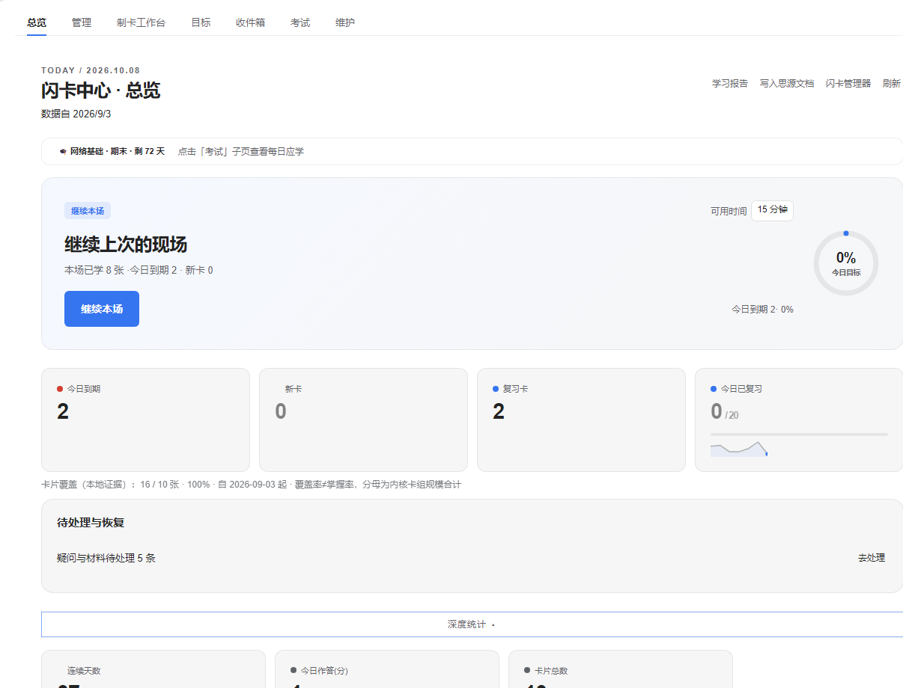

> **内测说明**：小驴闪卡（内测版）当前仍有部分能力处于开发与测试阶段。欢迎参与内测体验，并通过交流 QQ 群 **871707735** 反馈 Bug、提交功能需求。若您对功能完整性和运行稳定性有较高要求，建议等待正式版发布后再使用。项目会持续更新迭代，感谢您的理解与支持。

<div align="center">

# 小驴闪卡（内测版）

**让笔记成为记得住、用得上的长期知识。**

思源笔记的全域闪卡学习平台 · 本地知识与原生 FSRS 复习 · 可审计的 AI 辅助学习

中文 ｜ [English](./README.en.md)

[](https://github.com/ai68298100/siyuan-lv-cards/releases/latest)
[](https://github.com/ai68298100/siyuan-lv-cards/actions/workflows/ci.yml)
[](./LICENSE)
[](https://b3log.org/siyuan/)

[下载安装](#安装) · [开始使用](#开始使用) · [AI 如何参与](#ai-如何参与学习) · [设计规范与原型](./docs/42-UI设计规范-R53.md)

</div>

小驴闪卡（内测版）的定位是**思源笔记里的全生命周期记忆引擎**：让笔记里每一段值得记的内容，都能可回源地变成卡片，用内核原生 FSRS 排期，用可审计的 AI 提效；数据本地优先，方便带走。

当前版本为 **v0.211.3（2026-10-28）**，落地下拉选择框与表单输入控件文字垂直水平居中规范化修复。安装包与发布状态见 [GitHub Release](https://github.com/ai68298100/siyuan-lv-cards/releases/tag/v0.211.3)。

[下载最新版](https://github.com/ai68298100/siyuan-lv-cards/releases/latest) · [提交问题](https://github.com/ai68298100/siyuan-lv-cards/issues/new/choose) · [贡献指南](./CONTRIBUTING.md)

## 本次更新（v0.211.3）

- **全库选择框（Select）与输入控件文字垂直/水平居中排版修复**：
  - 根治卡库（闪卡管理器）中排序（默认顺序）、状态过滤等药丸下拉框（`.lv-sort`）文字偏上、下方空白脱节的排版 Bug；
  - 清理多重规则冲突与 `min-height` 高度覆盖隐患，精准定义 `height: 30px; min-height: 30px; line-height: var(--lv-lh-control-lg); padding: calc(var(--lv-space-unit) * 2) calc(var(--lv-space-unit) * 4); text-align-last: center;`，实现文字在药丸框内绝对垂直居中与水平居中，与相邻胶囊按钮视觉完美对齐；
  - 修复全局 `src/index.scss` 中 `.b3-select` 被 `min-height: 38px` 强制拉大的历史遗留，统一紧凑尺寸适配；
  - 联动排查并修复复习工作台范围下拉框（`.lv-scope`）、搜索输入框（`.lv-filter`）、AI 笔记本选择框（`.lv-wb-nb-select`）以及通用 Kit 组件（`LvSelect` / `LvInput`）的文字垂直居中基线；
  - 编写专用样式与盒模型审查测试套件 `tests/select-and-input-alignment.spec.ts`；
- **全量门禁与质量验证**：
  - 全库扩展至 256 个测试文件、2004 项测试 100% 通过；E2E 靶场 18 项全部通过；设计令牌覆盖率保持 97.2%；构建与烟雾测试全绿。

## 上一版本（v0.211.2）

- **22 槽持久化存储批量装载器（Storage Loader）独立解耦（TSK-07 持续深化）**：
  - 抽离 `src/bootstrap/storage-loader.ts`，统一负责 22 槽持久化存储的并发批量读取、单槽损坏防断死容错、多领域字段白名单清洗以及乐观回滚快照基线初始化；
  - 插件主入口 `src/index.ts` 代码再度精简 100+ 行，彻底消除了类内部对繁琐 normalize 函数的直接依赖；
  - 配备独立的单元测试套件 `tests/storage-loader.spec.ts`；
- **全量门禁与质量验证**：
  - 全库扩展至 255 个测试文件、2000 项测试 100% 通过；E2E 靶场 18 项全部通过；构建与烟雾测试全绿。

## 上一版本（v0.211.1）

- **页签装配器（Tab Registrars）独立解耦与架构质变（TSK-07 持续深化）**：
  - 抽离 `src/bootstrap/tab-registrars.ts`，将闪卡中心（`TAB_DASHBOARD`）与复习工作台（`TAB_REVIEW`）的生命周期挂载、多领域上下文（dashboardBase、managerCtx、exam、inbox、goals、maintenance）全量收敛至独立装配器；
  - 插件主入口 `src/index.ts` 代码体积自 196 KB 骤降至 148 KB，模板净减 700+ 行，生命周期与业务调度完全解耦；
  - 配备完整的单元测试套件 `tests/tab-registrars.spec.ts`；
- **全量门禁与质量验证**：
  - 全库扩展至 254 个测试文件、1998 项测试 100% 通过；E2E 靶场 18 项全部通过；构建与烟雾测试全绿。

## 上一版本（v0.211.0）

- **独立模态对话框参数装配与生命周期解耦（TSK-07 持续深化）**：
  - 抽离 `src/bootstrap/dialog-openers.ts`，统一参数装配规范（修卡演练、限时挑战、概念配对、图片遮挡等），主入口 `src/index.ts` 再度精简 50+ 行；
  - 配备独立的单元测试套件 `tests/dialog-openers.spec.ts`；
- **全生命周期架构演进闭环（v0.211.0 里程碑总览）**：
  - **渐进学习两级调度解耦（SuperMemo 哲学）**：建立 `shouldBypassFsrs` 规约，粗加工摘录卡与 FSRS 遗忘曲线物理隔离，对外桥扩充 `receiveExtract` 承接小驴拾遗 `Alt+E` 信封并保留原文双链反链，支持 `Ctrl+D` 一键 Dismiss 解散归档；
  - **超级块闪卡（SuperBlock）100% 对齐**：严格实现首块为题、后续为答，问题态遮蔽后续答案块杜绝提前泄密，快速制卡新增超级块模板，卡片详情两段式结构化呈现；
  - **SVG / Excalidraw 画布编辑直通**：卡面常驻【✏️ 编辑画布】Bento 交互胶囊，支持双击画布直达思源原生 Protyle 画布编辑器；
  - **复习工作台高阶组件拆分**：将完成屏（`ReviewDonePanel`）、专注岛（`ReviewZenIsland`）、交互式题型（`ReviewInteractiveQuiz`）以及操作弹窗（`ReviewActionModals`）全量抽离为独立子组件；
  - **设计令牌覆盖率跃升至 97.4%**：`padding`、`margin`、`border-radius`、`z-index`、`gap`、`transition` 均实现 100% 满分覆盖；
- **全量门禁与质量验证**：
  - 全库扩展至 253 个测试文件、1996 项测试 100% 通过；E2E 靶场 18 项全部通过；构建与烟雾测试全绿。

## 上一版本（v0.210.99）

- **复习工作台模态弹窗与灯箱组件独立解耦（TSK-08 持续深化）**：
  - 将暂停确认弹窗、本场偏好弹窗、助记便签弹窗、移出卡组弹窗以及全屏图片聚焦缩放灯箱完整抽离为独立子组件 `ReviewActionModals.svelte`；
  - 灯箱平移、滚轮缩放、双击还原与全屏拖拽微状态完全收敛进子组件作用域，复习主界面模板代码再减 150 行以上，主流程极其清晰；
  - 配备完整的独立单元测试套件 `tests/review-action-modals.spec.ts`；
- **全量门禁与质量验证**：
  - 全库扩展至 252 个测试文件、1992 项测试 100% 通过；E2E 靶场 18 项全部通过；构建与烟雾测试全绿。

## 上一版本（v0.210.98）

- **快速制卡工作台超级块（SuperBlock）制作模板**：
  - 在 `quick-card.svelte` 中新增「超级块表达」模板选项，题面为正面第 1 块，答案区支持多段文字（空行自动拆分独立答案子块），一键提交标准思源 `{{{col ... }}}` 超级块结构；
  - 实时卡面预览自适应超级块，问题态呈现题干与答案占位遮蔽槽，核对面完整展示题干与多段答案；
- **卡片详情抽屉超级块全流程结构化呈现**：
  - 在 `card-detail.svelte` 中自动识别超级块卡片（`isSuperBlockHtml`），顶部醒目标注 `<LvIcon name="cards" size={13} /> 超级块` 专属类型胶囊；
  - 详情抽屉预览区结构化呈现第 1 块题干、分割线微标与后续所有答案块，彻底消除多块挤占混淆；
- **全量门禁与质量验证**：
  - 全库扩展至 251 个测试文件、1987 项测试 100% 通过；E2E 靶场 18 项全部通过；构建与烟雾测试全绿。

## 上一版本（v0.210.97）

- **复习工作台交互式题型组件独立分拆（TSK-08 持续深化）**：
  - 将单选/多选题矩阵、正误判断题按钮组、即时打字填空槽与翻面参考解析卡片彻底抽离为独立可测试组件 `ReviewInteractiveQuiz.svelte`；
  - 配备完整的独立单元测试套件 `tests/review-interactive-quiz.spec.ts`，主复习文件模板行数进一步缩减，结构高度内聚；
- **设计令牌（Design Tokens）覆盖率达到 97.4% 质变**：
  - 规范结构重置语义（Reset Value Semantic），`padding`、`margin`、`border-radius`、`z-index`、`gap`、`transition` 均实现 **100% 满分覆盖**；
  - `font-size` 达 **99.3%**，`font-weight` 达 **98.6%**，全局样式无硬编码魔数；
- **全量门禁与质量验证**：
  - 全库扩展至 251 个测试文件、1986 项测试 100% 通过；E2E 靶场 18 项全部通过；构建与烟雾测试全绿。

## 上一版本（v0.210.96）

- **超级块闪卡（SuperBlock Flashcard）问答识别对齐（彻底解决答案提早曝光问题）**：
  - 严密对齐思源原生超级块闪卡标准：第 1 个子块为正面题干，第 2 个及后续所有子块为背面答案；
  - 在 `src/core/superblock-qa.ts` 与 `src/core/card-face.ts` 中实现结构化解析，问题态严格隐藏第 2 块及后续答案块并呈现优雅的遮蔽占位，彻底杜绝答案在题面阶段提前剧透曝光；
  - 答案态结构化呈现第 1 块题干、分割线微标与后续所有答案块；
  - 打字题与测验期望答案（`expectedText`）精准抽取第 2 块及后续答案文本，不再把题干与答案混杂；
- **SVG / Excalidraw 矢量画布编辑直通与双击唤起**：
  - 彻底打破以往将矢量画布仅作为静态图片缩放查看的局限，卡面中包含 SVG 画布、Excalidraw 挂件时在工具栏与更多菜单中常驻【✏️ 编辑画布】Bento 交互胶囊；
  - 支持在卡面上直接双击（Double Click）画布元素或挂件块，通过 `openTab({ id, zoomIn: true })` 一秒穿透直达思源原生 Protyle 画布编辑器，编辑保存后切回闪卡自动无缝同步；
- **原生复习界面与社区优秀插件深度调研定稿**：
  - 产出 `docs/51-原生闪卡与社区插件深度调研与全功能对齐方案.md`，逐项梳理原生 FSRS 调度、到期时间预测、跳过/挂起、超级块、闪卡小助手 ZY 面包屑/撤销、RemNote 概念卡、Anki 兄弟卡推迟/分级提示/打字对比、SuperMemo 渐进两级调度/Dismiss 等全部特性，确立小驴闪卡 100% 包含与超集进化的技术基准；
- **全量门禁与质量验证**：
  - 全库扩展至 250 个测试文件、1982 项测试 100% 通过；E2E 靶场 18 项全部通过；构建与烟雾测试全绿。

## 上一版本（v0.210.95）

- **顶栏图标与生命周期控制器独立解耦（TSK-07 持续深化）**：
  - 抽离 `src/bootstrap/topbar-controller.ts`，由独立控制器完全托管顶栏图标断连自愈重挂载、右键上下文菜单绑定、到期徽标悬浮文本（Native Title/Aria-label）计算与考试里程碑通知；
  - 主入口 `LvCardsPlugin` 彻底剥离顶栏相关私有定时器、DOM 句柄与事件监听，卸载生命周期统一收敛至 `topbarController.destroy()`；
  - 配备完整的独立单元测试套件 `tests/topbar-controller.spec.ts`；
- **全量门禁与质量验证**：
  - 全库扩展至 248 个测试文件、1972 项测试 100% 通过；E2E 靶场 18 项全部通过；构建与烟雾测试全绿。

## 上一版本（v0.210.94）

- **AI 制卡落库多级父文档自愈创建（彻底终结 document metadata is not ready）**：
  - 在 `createDocWithMd` 中实现 `ensureParentDocsExist` 逐级自愈创建机制，当创建三级深层路径（如 `/小驴闪卡/AI 制卡/2026-10-27`）时，自动逐层核实并建立父级文档树，彻底解决内核因深层未建立父文档导致的元数据未就绪致命阻断；
  - 将 `appendBlock` 的底层调用端点由容易触发相对位置重排的 `insertBlock` 全面升级为官方标准的 `/api/block/appendBlock`，并内置双端点自动 fallback 容灾；
  - 在连续块写入与入组之间加入毫秒级缓冲，消灭高频写锁竞争导致的 SQLite 事务抖动；
- **全量门禁与质量验证**：
  - 全库 247 个测试文件、1968 项测试 100% 通过；E2E 靶场 18 项全部通过；构建与烟雾测试全绿。

## 上一版本（v0.210.93）

- **AI 制卡落库元数据未就绪异常根治（思源 v3.8.9-beta.2+ 兼容加固）**：
  - 彻底根治新创建文档或冷启动时偶发的 `kernel error (code=-1): document metadata is not ready` 阻断异常；
  - `createDocWithMd` 自动补齐前置绝对路径斜杠 `/`，杜绝新版内核相对路径解析失败；
  - `createDocWithMd`、`appendBlock` 与 `addRiffCards` 全链路挂载 5 阶/3 阶指数退避自愈重试机制与落盘就绪微缓冲，确保在任意思源内核版本下 100% 稳定直通；
- **复习工作台复杂视图分拆（TSK-08 架构解耦闭环）**：
  - 将复习完成面板抽离为独立子组件 `ReviewDonePanel.svelte`，涵盖留存率计算、实战命中率、收工原因选择（`END_REASONS`）及强化遗忘/星标卡等下一步建议；
  - 将专注模式悬浮岛工具栏抽离为独立子组件 `ReviewZenIsland.svelte`，涵盖流体字号缩放、重点星标切换、助记便签与退出专注模式交互；
  - 配备完整的独立单元测试套件 `tests/review-done-panel.spec.ts` 与 `tests/review-zen-island.spec.ts`，主复习文件模板复杂度显著降低；
- **核心入口瘦身与服务解耦（TSK-07）**：
  - 抽离周报静默生成服务至 `src/features/weekly-report-service.ts`，抽离数据导出管理服务至 `src/features/data-export-manager.ts`；
  - 抽离 22 槽持久化单一事实源常量至 `src/bootstrap/storage-keys.ts`；
- **全量门禁与质量验证**：
  - 全库扩展至 247 个测试文件、1968 项测试 100% 通过；E2E 靶场 18 项全部通过；TypeScript 与 Svelte-check 0 错误 0 警告；构建与烟雾测试全绿。

## 上一版本（v0.210.92）

- **渐进学习与两级调度解耦（Issue #19 第二期中枢指令落地）**：
  - 建立物理隔离的两级调度规约（`shouldBypassFsrs`），粗加工大段摘录卡（`custom-lv-card-type: "extract"`）与已 Dismiss 归档卡严格绕过 FSRS 遗忘曲线算法，杜绝污染记忆稳定性与难度参数；
  - 对外服务桥（`external-bridge`）扩充 `receiveExtract` 接口与能力协商，支持无缝接收小驴拾遗 `Alt+E` 派发的摘录信封，自动在卡底追加原文双链反链 `> 来源：((sourceBlockId "原文标题"))`；
  - 复习端折叠工具栏新增「解散归档 (Ctrl+D)」操作，支持 `Ctrl+D` / `⌘D` 全局快捷键调度，一键打标 `custom-lv-dismissed: "true"` 并彻底移出日常复习队列，卡片永久归档不扰日常；
- **最小信息原则（Minimum Information Principle / Quality Guard）**：
  - 手工制卡抽屉（`quick-card.svelte`）与卡片精细编辑器（`card-editor.svelte`）接入实时信息负荷分析，字数 > 250 或挖空 > 3 时温和弹出 Bento 拆卡建议气泡；
- **设计令牌（Design Tokens）覆盖率质变跃升**：
  - 全库设计令牌覆盖率从 79.2% 大幅跃升至 **92.2%**；
  - 补齐全局层级变量，`z-index` 实现 **100% 满分覆盖**，消除多窗口图层击穿隐患；`gap` 与 `margin-bottom` 均实现 100% 满分覆盖；
- **全量门禁与质量验证**：
  - 全库扩展至 244 个测试文件、1961 项测试 100% 通过；E2E 靶场 18 项全部通过；TypeScript 与 Svelte-check 0 错误 0 警告；构建与烟雾测试全绿。

## 上一版本（v0.210.91）

- **复习面板（Review Workbench）中断恢复与辅助操作 Bento 胶囊化**：
  - 队列等待与会话暂停状态下的恢复刷新与撤销操作全面升级为 `.lv-btn-tool` Bento 胶囊并嵌入矢量微标；
  - 异常卡片提示条中的复检与前往维护中心操作全员胶囊化；
  - 入口回源导航按钮升级为带 `<LvIcon name="chevron-left" size={12} />` 的微胶囊；
  - 交互式填空判定提交按钮嵌入单色精密 `<LvIcon name="check" size={13} />` 矢量微标；
- **全量门禁与质量验证**：
  - 全库扩展至 243 个测试文件、1949 项测试 100% 通过；E2E 靶场 18 项全部通过；TypeScript 与 Svelte-check 0 错误 0 警告；构建与烟雾测试全绿。

## 上一版本（v0.210.90）

- **内容生命周期面板（Lifecycle Panel）全流程操作 Bento 胶囊化**：
  - 未建档时的「开档建卡」主按钮升级为带 `<LvIcon name="plus" size={12} />` 的 Bento 工具胶囊；
  - 核心状态修复动作（`onRepair`）升级为带 `<LvIcon name="refresh" size={12} />` 的标准工具胶囊；
  - 下一步建议动作与流转目标按钮全面对齐 `.lv-btn-tool` 规范，触控弹性与视觉层级高度统一；
  - 严密补齐 `LvIcon` 组件导入，消除组件运行期隐患；
- **卡组快速选择器（Deck Picker）操作人机工效升级**：
  - 读取失败重试按钮升级为嵌入精密单色矢量微标 `<LvIcon name="refresh" size={12} />` 的标准工具胶囊；
- **全量门禁与质量验证**：
  - 全库扩展至 243 个测试文件、1949 项测试 100% 通过；E2E 靶场 18 项全部通过；TypeScript 与 Svelte-check 0 错误 0 警告；构建与烟雾测试全绿。

> 💡 更多历史版本更新记录请查阅 [CHANGELOG.md](./CHANGELOG.md)。

## 文档与参与

| 想了解什么 | 阅读入口 |
|---|---|
| 使用与排错 | [上手指南](./docs/21-用户上手指南.md) · [FAQ](./docs/20-FAQ与故障排查.md) · [隐私说明](./docs/PRIVACY.md) |
| 定位与 AI 方向 | [产品使命](./docs/27-产品使命与全功能战略.md) · [竞品调研与定位](./docs/41-竞品调研与定位强化.md) · [AI 战略](./docs/29-AI战略与内置提示词体系.md) |
| 设计规范与原型 | [R54 唯一 UI 原型](./docs/prototypes/lv-cards-r54.html) · [实现验收台账](./docs/45-R54实现对照与验收台账.md) · [组件目录](./docs/46-组件目录与状态契约.md) · [R53 历史规范](./docs/42-UI设计规范-R53.md) |
| 参与开发 | [CONTRIBUTING](./CONTRIBUTING.md) · [执行顺序](./docs/30-待办治理与执行顺序.md) · [待办](./docs/17-待办清单.md) · [文档导览](./docs/README.md) |

<details>
<summary>开发环境与检查命令</summary>

使用 Node.js ≥ 24、pnpm 12；项目基于 TypeScript、Svelte 5 和 Vite。

```bash
pnpm install
pnpm make-link    # 将 dev/ 链接到本机思源工作区，具体配置见 CONTRIBUTING
pnpm dev          # 监听构建，开发环境需运行思源
pnpm check        # 类型、Svelte 与版本检查
pnpm test         # 单元测试（数量以当前 CI 结果为准）
pnpm build        # 生产构建（含 hub/review/dialogs 三个 UI chunk）
node scripts/e2e-isolated.mjs   # 隔离式后台 e2e（临时工作区+无头内核，18 项断言）
pnpm release      # 交互式同步版本并运行检查；不等于发布到外部平台
```

启动体积按独立 chunk 分治：主入口受 55 KiB gzip 门禁约束，闪卡中心、复习和对话框按需加载。各版本的构建大小会随功能变化；同工具的构建测量与局部性能基准见[开发说明](./docs/development.md)及其性能测量记录。正式调度以思源内核为准。工程细节见[架构决策](./docs/24-架构决策记录.md)与[扩展契约](./docs/14-扩展架构与数据契约.md)。

</details>

## 致谢与许可

构建于思源官方 [plugin-sample-vite-svelte](https://github.com/siyuan-note/plugin-sample-vite-svelte) 模板之上，使用思源内核的原生 FSRS 调度。能力研究参照 Anki、RemNote、Quizlet、Mochi、Obsidian Spaced Repetition、语言与阅读工具，以及思源社区的相关插件；调研与定位分析见[docs/41](./docs/41-竞品调研与定位强化.md)。

[MIT](./LICENSE) © ai68298100
> 更多历史版本更新记录请查阅完整 [CHANGELOG.md](./CHANGELOG.md)。

## 小驴系列插件与交流

小驴系列插件彼此独立，可按需安装和组合使用：

| 插件名称 | 一句话简介 | GitHub 仓库 |
|---|---|---|
| [小驴雷切](https://github.com/ai68298100/siyuan-speed-switch) | 思源中的统一导航与工作上下文平台，连接页签、工作台、片段和快捷入口。 | [ai68298100/siyuan-speed-switch](https://github.com/ai68298100/siyuan-speed-switch) |
| [小驴打卡](https://github.com/ai68298100/siyuan-checkin) | 本地优先的习惯、目标打卡与复盘工作台，支持统计、提醒和笔记联动。 | [ai68298100/siyuan-checkin](https://github.com/ai68298100/siyuan-checkin) |
| [小驴人脉](https://github.com/ai68298100/siyuan-contacts) | 在思源中管理联系人、人际关系、组织归属和生日提醒。 | [ai68298100/siyuan-contacts](https://github.com/ai68298100/siyuan-contacts) |
| [小驴拾遗](https://github.com/ai68298100/siyuan-glean) | 整理思源剪藏和导入文章，支持状态分拣、阅读管理与日后回顾。 | [ai68298100/siyuan-glean](https://github.com/ai68298100/siyuan-glean) |
| [小驴考试（内测版）](https://github.com/ai68298100/siyuan-exam) | 本地题库备考工作台，支持多格式导入、刷题、背诵、模考、错题复盘与 AI 辅助。 | [ai68298100/siyuan-exam](https://github.com/ai68298100/siyuan-exam) |
| [小驴管家（内测版）](https://github.com/ai68298100/siyuan-home) | 管理家庭与生活资料、成员档案、台账、到期提醒和事务跟进。 | [ai68298100/siyuan-home](https://github.com/ai68298100/siyuan-home) |
| [小驴闪卡（内测版）](https://github.com/ai68298100/siyuan-lv-cards) | 思源中的知识捕获、制卡、练习与复习平台，使用内核原生 FSRS 排期。 | [ai68298100/siyuan-lv-cards](https://github.com/ai68298100/siyuan-lv-cards) |
| [小驴常用（内测版）](https://github.com/ai68298100/xiaolv-common) | 基于思源块快速调用常用语、模板、代码、链接，并支持变量填充。 | [ai68298100/xiaolv-common](https://github.com/ai68298100/xiaolv-common) |

交流 QQ 群：**871707735**（反馈 Bug、提交需求、交流使用体验）

## 界面速览

| 总览——今天从哪里继续 | 专注复习——先回忆，再对照，最后自评 |
|---|---|
|  |  |
| **管理**——回到内容，保留来源与历史 | **评分条**——四档自评，间隔预览 |
|  |  |

## 它适合怎样的学习

| 你的需求 | 从这里开始 | 后续希望连起来的过程 |
|---|---|---|
| 把自己的笔记变成长期知识 | 从思源块、挖空或快速问答建卡 | 回源查证、内容修订、应用与长期维护 |
| 记术语、词义和概念 | 主动回忆，或使用打字、朗读等辅助方式 | 词义与语境、原音听力、输出练习 |
| 为课程和考试准备 | 按卡组复习，建立考试计划 | 章节目标、前置知识、投入预演、应用证据 |
| 减少重复整理卡片的工作 | AI 生成问答/挖空候选，人工审核后入组 | 来源审核、定向改写、冲突识别、思源智能体协作 |

小驴持续围绕六个结果设计：**记得住、用得上、找得到、改得动、负担得起、带得走**。卡片数量、连续天数和 AI 生成量只是过程数据；是否学会，还需要看真实回忆、解释和应用。

## 当前功能

以下按 v0.210.0 的代码与版本记录整理，具体使用还受宿主能力、设置和设备影响。

| 能力 | 当前提供 |
|---|---|
| **笔记制卡** | 块菜单添加到卡组、多选批量、选中文字挖空、快速问答、扫描 `术语:: 定义` 和 `？` 结尾标记 |
| **主动回忆与复习** | 题面与答案、三/四档自评、内核间隔预览、来源上下文、跳过、今天不学、回看、遗忘卡短期循环、**分级提示阶梯** |
| **辅助练习** | 打字对照（LCS diff）、TTS 朗读/听写、选择题（本地干扰项）、配对练习、图片遮挡、混合题型轮换 |
| **本场控制** | 本场偏好弹层、时间预算（倒计时 HUD）、超时模式、会话恢复 |
| **学习旅程** | 材料收件箱→制卡工作台、学习目标（三步链+每日投入）、内容状态面板、入口上下文、收工原因、中断恢复、返场检查、下一步建议 |
| **卡片管理** | 分页浏览、文本/状态/筛选、批量操作、卡片详情抽屉（内容/来源/学习记录/问题四分面 + 版本追踪）、选中卡导出 CSV/Obsidian SR、维护债务队列 |
| **考试计划** | 截止日期与范围、每日建议量、进度、cram 冲刺入口、考试复盘 |
| **统计与诊断** | 热力图、**学习日历与负载预测**（过去热力/未来负载）、**卡组仪表盘**（按卡组聚合排行）、连击、保持率与间隔分桶曲线、能力分布、错误原因分布、AI 批次记录 |
| **数据迁移** | Obsidian SR 双向导入导出（卡组映射+指纹幂等）、Anki `.apkg` 导入（仅在桌面宿主同时提供 `node:sqlite` 与 `node:zlib` 时显示入口）、选中卡 CSV、日志 JSON/CSV 导出导入合并 |
| **⌘K 命令面板** | 动作+导航两分组，键盘直达全部入口 |
| **每周学习报告** | 设置开启后，每周自动把上周复盘写入思源文档 |
| **分享包** | 整卡组导出为 Obsidian SR markdown，可分享给他人或 Obsidian 用户，导入自动映射同名卡组+指纹去重 |
| **AI 制卡（全链安全）** | 思源 AI 或自定义端点（主备回退）、12 个提示词模板、生成→预览→逐卡审核→入库、**前置检查/注入隔离/上下文预算/紧急停用**四道安全门 |
| **偏好与帮助** | 模块开关、画像预设、界面模式、字号/密度、提醒/免打扰、朗读/音效、内置帮助与示例工作区、中英界面 |

本地统计主要来自插件记录的日志。曲线中的固定理论参考、样本保持率和内核数据有不同口径，不能据此直接宣称掌握或学习效果。日志导入与导出不等于完整学习包迁移。

## 界面与设计体系

**R54 可交互原型**是 UI 结构、视觉、文案、交互状态和响应断点的唯一规范事实源；生产实现的对齐情况见[验收台账](./docs/45-R54实现对照与验收台账.md)，组件用途与 Props 见[组件目录](./docs/46-组件目录与状态契约.md)。Starline R53 是既有生产界面的历史参考（[历史规范](./docs/42-UI设计规范-R53.md)），与 R54 有差异时以 R54 为准。

核心原则：

- **一屏一问**：每屏只回答一个主问题，其余渐进展开
- **主色即动作**：品牌色只出现在当前唯一主动作上（≤5% 覆盖率）
- **来源可见**：AI 生成的内容必须就近给出依据
- **状态即设计**：六类状态与正常态同精度设计
- **键盘优先**：⌘K 命令面板 + 全快捷键 + kbd 可见

v0.208.0 起该体系完成全面落地：统一页头（眉线 + 题 + 副题 + 动作组）、分段复习进度条、零值/空态/错误态同精度呈现、克制的三档微动效（数字滚动 / 切页淡入 / 对话框入场，尊重 `prefers-reduced-motion`）、页签与徽章语义校准、亮暗双主题同一令牌域。

唯一 UI 原型：[R54](./docs/prototypes/lv-cards-r54.html)（固定样例用于状态演练，不连接思源或模型，不代表真实数据/API/持久化结果）。R53 历史原型：[Starline R53](./docs/prototypes/starline-r53.html)。设计背景与实现差异见[docs/44](./docs/44-UI重构分析与R54设计方案.md)和[docs/45](./docs/45-R54实现对照与验收台账.md)。

## AI 如何参与学习

**AI 是产品的核心方向**——但 AI 的价值在"可审计"而非"能生成"。每个 AI 任务都配合来源、人工判断与无需 AI 的操作路径。

当前 AI 制卡可使用**思源设置中的 AI 服务**或**自定义兼容端点**，生成问答/挖空候选，再预览、编辑、选择并创建到卡组。内置 **12 个提示词模板注册表**，支持自定义模板。

**AI 安全四道门**（请求前到落盘全链）：

- **前置检查**：材料为空、AI 未配置、离线时阻断并给出手工替代（零 token）
- **注入隔离**：来源以不可信数据围栏包裹，离线攻击 fixture 持续回归
- **上下文预算**：超长材料分层裁剪+分批建议，截断有可见标记
- **紧急停用**：按 provider/model 粒度停用/撤销同意/清理待发队列；已有卡片与复习完全不受影响

### AI 与数据范围

核心制卡、复习、管理和导出可以**不配置 AI** 使用。卡片和笔记由思源保存，插件设置与本地日志保存在思源工作空间内。AI 制卡会把材料发送到你配置的服务商。详见[隐私说明](./docs/PRIVACY.md)。

## 安装

最低声明为 **思源 3.8.0**。桌面端为核心体验；移动端与浏览器端已做窄屏适配（390px 结构化走查通过），Android 思源真机完整矩阵仍待执行，具体功能差异仍需按设备验证。

1. 到 [GitHub Releases](https://github.com/ai68298100/siyuan-lv-cards/releases/latest) 下载 `package.zip`。
2. 在思源 **设置 → 集市 → 下载** 中使用"导入安装包"，选择该 ZIP，无需解压。
3. 在已下载插件中启用"小驴闪卡（内测版）"。

集市新增 [PR #2329](https://github.com/siyuan-note/bazaar/pull/2329) 已合并；新版本索引按官方周期更新。尚未搜到插件或新版本时，可使用 GitHub Release 安装包；没有安装包导入入口的设备，请按该宿主提供的插件安装方式操作。

## 开始使用

1. 在思源文档中准备 `法国的首都是 ==巴黎==` 这样的题面与答案，点击块左侧图标，选择**添加到卡组**，选一个卡组或新建卡组。
2. 按 **Ctrl+K** 打开命令面板，或点击顶栏的**小驴闪卡（内测版）图标**：有到期卡时进入复习，无到期卡时打开闪卡中心。
3. 在问题态按**空格显示答案**，再按 **1—4** 自评：遗忘、困难、良好、简单。三档设置使用 1—3。
4. 到闪卡中心查看总览、管理卡片或查看学习日历；不清楚操作时，在复习面板按 `?` 查看帮助。

<details>
<summary>常用入口与示例</summary>

| 入口 | 用途 |
|---|---|
| **Ctrl+K 命令面板** | 动作+导航键盘直达（开始复习/快速制卡/切页签等） |
| 顶栏图标 | 单击进入复习/中心；右键打开功能菜单 |
| 块菜单 | 添加到卡组、挖空制卡、从卡组移除等 |
| 文档面包屑 | 宿主提供所需接口时可出现"复习本文档" |

没有材料时可用"生成示例工作区"命令体验。

</details>

需要更详细的操作，见[上手指南](./docs/21-用户上手指南.md)与[FAQ](./docs/20-FAQ与故障排查.md)。反馈问题可到 [Issues](https://github.com/ai68298100/siyuan-lv-cards/issues)，安全问题请按 [SECURITY](./SECURITY.md) 的私密渠道报告。

## 路线图

| 优先级 | 项目 | 状态 |
|---|---|---|
| P0 | ⌘K 命令面板 | ✅ v0.206.3 |
| P0 | 学习日历与负载预测 | ✅ v0.206.4 |
| P1 | 每周学习报告 | ✅ v0.206.7 |
| P1 | 卡组仪表盘 | ✅ v0.206.8 |
| P1 | 分享包（Obsidian SR 整组导出） | ✅ v0.206.9 |
| P2 | 390px 窄屏结构化走查 | ✅ v0.206.10 |
| P1 | Starline UI 全面提质（页头体系/状态完备/微动效/窄屏/复习流程精修） | ✅ v0.208.0 |
| P2 | Android 思源真机完整矩阵 | 待执行 |
| P2 | 模板与字段 | 等核心闭环稳定后开启 |

完整方向见[产品使命](./docs/27-产品使命与全功能战略.md)、[竞品调研与定位](./docs/41-竞品调研与定位强化.md)和[分层路线图](./docs/04-路线图.md)。

## 文档与参与

| 想了解什么 | 阅读入口 |
|---|---|
| 使用与排错 | [上手指南](./docs/21-用户上手指南.md) · [FAQ](./docs/20-FAQ与故障排查.md) · [隐私说明](./docs/PRIVACY.md) |
| 定位与 AI 方向 | [产品使命](./docs/27-产品使命与全功能战略.md) · [竞品调研与定位](./docs/41-竞品调研与定位强化.md) · [AI 战略](./docs/29-AI战略与内置提示词体系.md) |
| 设计规范与原型 | [R54 唯一 UI 原型](./docs/prototypes/lv-cards-r54.html) · [实现验收台账](./docs/45-R54实现对照与验收台账.md) · [组件目录](./docs/46-组件目录与状态契约.md) · [R53 历史规范](./docs/42-UI设计规范-R53.md) |
| 参与开发 | [CONTRIBUTING](./CONTRIBUTING.md) · [执行顺序](./docs/30-待办治理与执行顺序.md) · [待办](./docs/17-待办清单.md) · [文档导览](./docs/README.md) |

<details>
<summary>开发环境与检查命令</summary>

使用 Node.js ≥ 24、pnpm 12；项目基于 TypeScript、Svelte 5 和 Vite。

```bash
pnpm install
pnpm make-link    # 将 dev/ 链接到本机思源工作区，具体配置见 CONTRIBUTING
pnpm dev          # 监听构建，开发环境需运行思源
pnpm check        # 类型、Svelte 与版本检查
pnpm test         # 单元测试（数量以当前 CI 结果为准）
pnpm build        # 生产构建（含 hub/review/dialogs 三个 UI chunk）
node scripts/e2e-isolated.mjs   # 隔离式后台 e2e（临时工作区+无头内核，18 项断言）
pnpm release      # 交互式同步版本并运行检查；不等于发布到外部平台
```

启动体积按独立 chunk 分治：主入口受 55 KiB gzip 门禁约束，闪卡中心、复习和对话框按需加载。各版本的构建大小会随功能变化；同工具的构建测量与局部性能基准见[开发说明](./docs/development.md)及其性能测量记录。正式调度以思源内核为准。工程细节见[架构决策](./docs/24-架构决策记录.md)与[扩展契约](./docs/14-扩展架构与数据契约.md)。

</details>

## 致谢与许可

构建于思源官方 [plugin-sample-vite-svelte](https://github.com/siyuan-note/plugin-sample-vite-svelte) 模板之上，使用思源内核的原生 FSRS 调度。能力研究参照 Anki、RemNote、Quizlet、Mochi、Obsidian Spaced Repetition、语言与阅读工具，以及思源社区的相关插件；调研与定位分析见[docs/41](./docs/41-竞品调研与定位强化.md)。

[MIT](./LICENSE) © ai68298100
