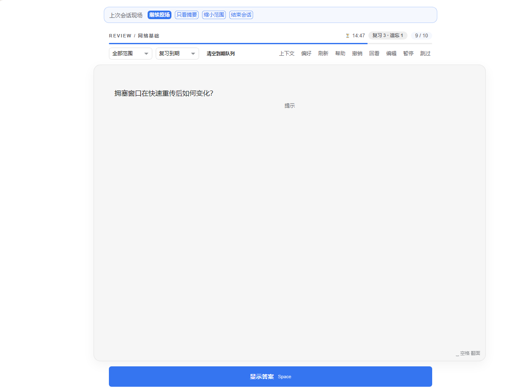
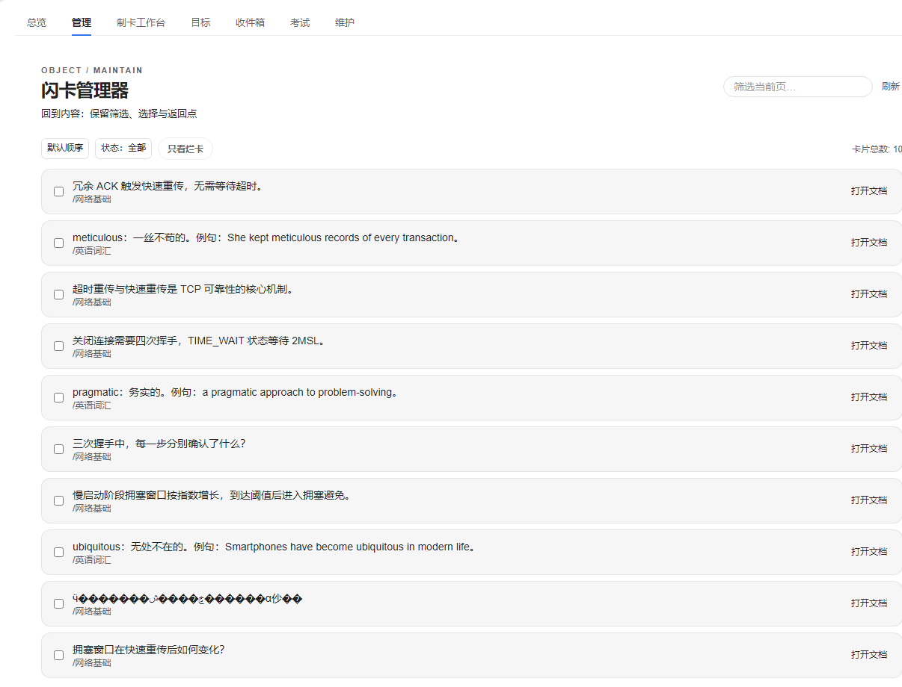
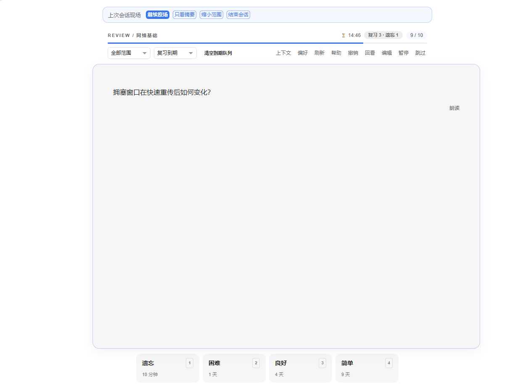

> **内测说明**：小驴闪卡（内测版）当前仍有部分能力处于开发与测试阶段。欢迎参与内测体验，并通过交流 QQ 群 **871707735** 反馈 Bug、提交功能需求。若您对功能完整性和运行稳定性有较高要求，建议等待正式版发布后再使用。项目会持续更新迭代，感谢您的理解与支持。

<div align="center">

# 小驴闪卡（内测版）

**让笔记成为记得住、用得上的长期知识。**

思源笔记的全域闪卡学习平台 · 本地知识与原生 FSRS 复习 · 可审计的 AI 辅助学习

中文 ｜ [English](./README.en.md)

[](https://github.com/ai68298100/siyuan-lv-cards/releases/latest)
[](https://github.com/ai68298100/siyuan-lv-cards/actions/workflows/ci.yml)
[](./LICENSE)
[](https://b3log.org/siyuan/)

[下载安装](#安装) · [开始使用](#开始使用) · [核心功能与作用](#核心功能与作用全景) · [AI 如何参与](#ai-如何参与学习) · [设计体系](#界面与设计体系)

</div>

小驴闪卡（内测版）的定位是**思源笔记里的全生命周期记忆引擎**：让笔记里每一段值得记的内容，都能可回源地变成卡片，用内核原生 FSRS 排期，用可审计的 AI 提效；数据本地优先，方便带走。

当前版本为 **v0.217.0（2026-10-29）**，包含完整的全生命周期闪卡记忆体系。安装包与发布状态见 [GitHub Release](https://github.com/ai68298100/siyuan-lv-cards/releases/tag/v0.217.0)。

[下载最新版](https://github.com/ai68298100/siyuan-lv-cards/releases/latest) · [提交问题](https://github.com/ai68298100/siyuan-lv-cards/issues/new/choose) · [贡献指南](./CONTRIBUTING.md)

## 最新版本更新（v0.217.0 · 2026-10-29）

- **高危缺陷根治**：
  - 修复复习提交流锁保护与重现卡异常穿透，杜绝工作台被锁死；
  - 修复 `undo`（`p`/`q`）快捷键在问题态失效的交互直觉违背，无需翻面即可即时撤销；
  - 修正命中率与留存率统计公式，消除遗忘卡重复扣除及全盘遗忘时误判 100% 满分的严重计算 BUG；
  - 修复快速改期时区偏移，杜绝东八区凌晨改期退回前一天的时钟漂移；
  - 修复内核范围查询穿透错误与 Anki 导入临时 SQLite 文件磁盘泄漏；
  - 修复今日不学（Suspend Today）跨天未滚转问题。
- **UI 与无障碍改善**：
  - 全局抽屉 `.lv-drawer` 纳入设计令牌重置体系；
  - 补齐设计令牌并重构暗色模式状态色徽标反差，满足 WCAG AA 4.5:1 对比度标准；
  - 规范模态弹窗 z-index 层级，引入原生 Svelte Action 焦点陷阱（`use:trapFocus`）；
  - 修复面包屑非法 HTML 嵌套结构。
- **大库性能与伸缩性优化**：
  - 消除复习评分时 2 万条学习记录的多重深拷贝与无效规范化运算，优先采用 V8 原生 `structuredClone`；
  - `knownCards` 检索复杂度由 $O(N)$ 优化至 $O(1)$，通过 `WeakMap` 维护 `Set<string>` 内存缓存；
  - 复习出题队列质量检测引入自适应候选窗口预截断，大幅缩短大卡组首卡加载延迟；
  - 卡片管理台预缓存纯文本摘要，消除排序比较中的高频正则开销。
- **工程验证指标**：
  - 全库扩展至 289 个测试文件、2315 项测试 100% 通过；TypeScript 类型检查 0 错误；Svelte 诊断 0 错误 0 警告；构建与发布包 smoke-dist 全部通过。

<details>
<summary>📜 点击展开查看历史版本更新记录（v0.216.3 及更早版本）</summary>

### v0.216.3（2026-10-29）
- **队列排除卡片合并与活跃卡片过滤解耦（`core/review-queue-pipeline.ts`）**：提炼 `combineExcludedCardIDs`、`filterActiveSessionCards` 与 `mergeQualityExcludedCardIDs`，使用 Set 将跳过和今日不学卡片的过滤优化至 O(1) 级别。
- **会话恢复重启倒计时前置判定解耦（`core/review-countdown.ts`）**：提炼 `shouldRestartCountdownOnResume` 纯函数统一校验问题态与题面就绪。
- **验证**：289 个测试文件、2314 项测试 100% 通过。

### v0.216.2（2026-10-29）
- **卡片可评分判定与评级触感波形解耦（`core/card-actions.ts` & `core/haptic.ts`）**：提炼 `canRateCurrentCard` 集中校验题面存在、会话非暂停、题面答案态与非忙碌状态；提炼 `getRatingHapticPattern` 标准化遗忘（强确认波形）与轻触波形。
- **复习面板根容器/卡片聚焦控制器解耦（`core/card-interactions.ts`）**：提炼 `focusReviewRootOrCard` 标准化归还焦点至复习根元素或卡片主体。
- **验证**：289 个测试文件、2309 项测试 100% 通过。

### v0.216.1（2026-10-29）
- **容器内部事件判定统一（`core/card-interactions.ts`）**：提炼 `isEventInsideContainer` 纯函数标准化判断目标是否为指定容器或其子节点，消除 3 处内联 DOM 判定。
- **清空重置会话进度载荷构建解耦（`core/session-state.ts`）**：提炼 `createResetSessionProgress` 消除组件层残留的计数器直接实例化。
- **验证**：289 个测试文件、2304 项测试 100% 通过。

### v0.216.0 里程碑（2026-10-29）
- **卡面就绪判定与范围键规范化解耦（`core/card-face.ts` & `core/scope-preset.ts`）**：提炼 `isCardFaceReady` 与 `normalizeScopeKey` 纯函数。
- **所属文档路径查询 SQL 构造解耦（`core/review-breadcrumbs.ts`）**：提炼 `buildHPathQuerySql` 纯函数生成标准 SQL 并内置单引号防注入。
- **验证**：289 个测试文件、2301 项测试 100% 通过（突破 2300 项测试里程碑）。

### v0.215.0 里程碑（2026-10-29）
- **出题队列截取与回看快照构建解耦（`core/card-actions.ts`）**：提炼 `createLastAnsweredSnapshot` 与 `sliceQueueAfterCurrent`。
- **返场多语言字典点分路径安全读取解耦（`core/return-check.ts`）**：提炼 `resolveI18nPath` 安全解析多层嵌套键。
- **验证**：289 个测试文件、2243 项测试 100% 通过。

### v0.214.0 里程碑（2026-10-29）
- **主复习组件（`src/ui/review.svelte`）代码行数自 3412 行削减至 2342 行（累计净减超 1070 行）**。
- **提炼 8 大专用子组件与数十个纯逻辑引擎**：包括 `ReviewReadyDashboard`、`ReviewToolbar`、`ReviewRatingBar`、`ReviewErrorTagBar`、`ReviewCountdownBanner`、`ReviewRescheduleModal`、`ReviewSessionPrefs`、`ReviewContextDrawer`。
- **软键盘自适应、卡面交互状态机、全屏灯箱缩放与题型选择解耦**。

### v0.212.4（2026-10-28）
- **空队列复习就绪看板独立解耦（`ReviewReadyDashboard.svelte`）**：组件内部自收敛范围切换、异常隔离警示、三大便当盒功能矩阵（Cram 冲刺、制卡、卡库管理）及返回主页。

### v0.212.3（2026-10-28）
- **复习工作台底部评分条独立解耦（`ReviewRatingBar.svelte`）**：组件内部自收敛未翻面主动作、已翻面三档/四档评分、建议评分高亮与物理按键反馈。
- **遗忘卡错误原因标注条独立解耦（`ReviewErrorTagBar.svelte`）**：自带 7 种认知失误类型标签渲染与无障碍状态播报。

### v0.212.2（2026-10-28）
- **番茄专注与限时到期提醒独立解耦（`ReviewCountdownBanner.svelte`）**：25 分钟番茄周期提醒与超时到点自评提醒。
- **闪卡管理器支持大纲挖空与超级块卡型筛选**：在卡片管理器药丸工具条中新增 `cardTypeFilter`。

### v0.212.1（2026-10-28）
- **复习工作台顶栏与二级工具菜单独立解耦（`ReviewToolbar.svelte`）**：剥离顶栏工具行与折叠气泡菜单，收敛范围下拉、字号缩放、星标、疑问、暂停与跳过。

### v0.212.0（2026-10-28）
- **沉睡知识自动挖掘一键批量收纳进待提炼收件箱（Extract Inbox 闭环）**：打通沉睡高亮孤岛与收件箱通道。
- **快速改期面板独立解耦（`ReviewRescheduleModal.svelte`）**：自带天数范围合法性校验、到期时间戳精准预览与自愈重试。

### v0.211.0 里程碑（2026-10-28）
- **渐进学习两级调度解耦（SuperMemo 哲学）**：建立 `shouldBypassFsrs` 规约，粗加工摘录卡严格绕过 FSRS，支持 `Ctrl+D` 一键解散归档。
- **超级块闪卡 100% 对齐**：首块为题、后续为答，问题态遮蔽后续答案块杜绝提前泄题。
- **SVG / Excalidraw 画布编辑直通**：常驻编辑画布胶囊，双击画布直达思源原生 Protyle 画布编辑器。
- **设计令牌覆盖率跃升至 97.4%**。

> 💡 更多历史版本更新记录请查阅完整 [CHANGELOG.md](./CHANGELOG.md)。
</details>

## 界面速览

| 总览——今天从哪里继续 | 专注复习——先回忆，再对照，最后自评 |
|---|---|
|  |  |
| **管理**——回到内容，保留来源与历史 | **评分条**——四档自评，间隔预览 |
|  |  |

## 它适合怎样的学习

| 你的需求 | 从这里开始 | 后续希望连起来的过程 |
|---|---|---|
| 把自己的笔记变成长期知识 | 从思源块、挖空或快速问答建卡 | 回源查证、内容修订、应用与长期维护 |
| 记术语、词义和概念 | 主动回忆，或使用打字、朗读等辅助方式 | 词义与语境、原音听力、输出练习 |
| 为课程和考试准备 | 按卡组复习，建立考试计划 | 章节目标、前置知识、投入预演、应用证据 |
| 减少重复整理卡片的工作 | AI 生成问答/挖空候选，人工审核后入组 | 来源审核、定向改写、冲突识别、思源智能体协作 |

小驴持续围绕六个结果设计：**记得住、用得上、找得到、改得动、负担得起、带得走**。卡片数量、连续天数和 AI 生成量只是过程数据；是否学会，还需要看真实回忆、解释和应用。

## 核心功能与作用全景

小驴闪卡围绕**「知识捕获 -> 渐进加工 -> 科学记忆 -> 多维测验 -> 资产维护」**完整闭环设计，彻底解决“笔记记了就忘、卡片制了不背、积压如山挫败”的痛点：

### 1. 深度笔记制卡（从散落笔记到可测试卡片）

| 功能特性 | 核心能力说明 | 解决的痛点与作用 |
|---|---|---|
| **块级极速入组** | 点击思源块左侧图标一键推入指定卡组，或多选批量入组 | 无需离开当前笔记，不打断阅读与记录心流 |
| **高亮划词挖空** | 选中文字按 `==` 或点击挖空按钮生成标准挖空卡片 | 随读随划，秒级将核心重点提炼为可测验卡片 |
| **大纲/列表树挖空** | 智能保留嵌套大纲树状骨架，对关键节点打上灵动遮罩 | 专为法学法条、医学解剖、协议架构等体系化知识记忆设计 |
| **超级块结构化问答** | 首块为题面，后续子块为多段答案，问题态安全遮蔽防泄题 | 适合长篇问答与多要点论述，彻底杜绝传统闪卡提前剧透问题 |
| **智能语法扫描** | 自动扫描笔记中 `术语 :: 释义` 与带有 `？` 问答标记的内容 | 兼容既有 Markdown 问答笔记，零成本迁移存量知识资产 |

### 2. 科学抗遗忘复习（FSRS 间隔重复引擎）

| 功能特性 | 核心能力说明 | 解决的痛点与作用 |
|---|---|---|
| **内核原生 FSRS** | 依托思源内核原生 Free Spaced Repetition Scheduler 算法 | 告别过时的 SM-2 僵硬固定乘数，自适应个人真实遗忘速率 |
| **到期日与间隔预览** | 评分按钮下方实时预览本次评分对应的下一次到期时间与天数 | 用户对复习节奏心中有数，消除黑盒打分的不安全感 |
| **分级提示阶梯** | 卡顿时按 `h` 依次展开：回忆目标 -> 关键词 -> 上下文 -> 答案 | 解决“卡壳只能直接翻面”的二极管体验，建立循序渐进的记忆检索支架 |
| **遗忘卡短期循环** | 当场评为遗忘（Again）的卡片打上标签，并在几分钟后自动重现 | 在一次复习内完成二次强化，防止遗忘卡直接滚入明日造成积压 |
| **层级来源面包屑** | 卡顶展示所属笔记本、文档根标题及层级路径，支持极简折叠 | 消除原子卡孤立感，随时掌握知识语境；专注时可折叠减少干扰 |
| **来源上下文抽屉** | 点击或快捷键滑出文档来源块的前后 2 块完整上下文 | 做题存疑时一秒回源查证，无需切走界面打乱做题节奏 |

### 3. 多模态与交互式题型（多重感官强化认知）

| 功能特性 | 核心能力说明 | 解决的痛点与作用 |
|---|---|---|
| **打字默写与对比** | 键盘实时输入拼写，支持 LCS 动态规划字符级逐字标色对比 | 针对外语单词、代码命令、专有名词，杜绝“看眼熟但写不对” |
| **本地干扰项选择题** | 自动提取后续卡片答案作为干扰项，无可靠选项时优雅退回自由回忆 | 适合碎片时间快速刷题与识别性自测，绝不伪造虚假干扰项 |
| **交互判断题与填空** | 识别正误判断与下划线填空，快捷键 A/B/C/D 与 1/2 直达 | 丰富复习形式，调动做题兴趣，减轻单调翻面疲劳 |
| **图片与画布遮挡** | 支持多矩形选区遮蔽图片重点区域，逐块点击揭晓核对 | 医学解剖图谱、电路原理图、思维导图记忆的终极利器 |
| **SVG / Excalidraw 画布编辑** | 卡面常驻画布编辑微标，双击直接放大跳转进入原生编辑器 | 图文画布与闪卡双向打通，编辑保存后无缝同步卡面 |
| **TTS 智能朗读与听写** | Web Speech 纯前端自适应中英发音，支持问题态答案自动听写 | 适合语言学习、听力磨耳朵，解放双眼进行沉浸式听记 |

### 4. 学习节奏与心流控制（告别积压挫败）

| 功能特性 | 核心能力说明 | 解决的痛点与作用 |
|---|---|---|
| **单场时间预算** | 设定 15/25/30 分钟时限，HUD 实时呈现可完成预测与倒计时 | 预算到点中性提醒收工，绝不强制打断，保护专注心流 |
| **番茄专注周期** | 内置 25 分钟标准番茄周期，到点提示休息伸展与会话保存 | 避免长时间连续刷题造成脑疲劳与边际效用递减 |
| **中断恢复四分支** | 关窗或切后台重进时提供：继续原场/只看摘要/缩小范围/清场重开 | 意外中断不丢进度，让用户掌控现场而非程序盲目强推 |
| **长期返场检查与减负** | 跨天返场或积压 > 100 时给出负荷解释与减负出路（聚焦高优/只读） | 告别“几天没背打开软件看到几千张积压直接卸载”的复发性挫败 |
| **认知错误原因打标** | 遗忘后旁路可选打标（概念混淆/马虎审题/生疏未学/卡片质量差等） | 记录记忆失误的根因，为后续知识重构与卡片优化提供凭据 |

### 5. 全生命周期卡片管理与债务治理

| 功能特性 | 核心能力说明 | 解决的痛点与作用 |
|---|---|---|
| **闪卡管理器全览** | 分页检索、全文字词过滤、多状态/卡组/笔记本/标签复合筛选 | 轻松管理数千乃至数万张卡片，全局视野一手掌握 |
| **卡片详情四分面抽屉** | 一览内容预览、来源溯源、历史复习轨迹日志与问题诊断 | 全息透视一张卡片的诞生、遗忘与掌握史 |
| **疑难卡（Leech）预警** | 多次遗忘自动标记疑难卡，并建议拆解、重构或补充助记 | 阻断坏卡反复空耗精力，践行学习科学“最小信息原则” |
| **助记便签（Memo）** | 卡面随时随地追加私人助记线索或幽默口诀，同步保存至块备注 | 给未来的自己留线索，跨越记忆障碍点 |
| **就地移出与一键归档** | 复习时按 `Ctrl+D` 一键解散归档（Dismiss）或安全移出卡组 | 知识已内化或过期失效时一键归档，保持复习库高纯度 |

### 6. 学习目标、备考与统计可视化

| 功能特性 | 核心能力说明 | 解决的痛点与作用 |
|---|---|---|
| **学习目标三步链** | 建立「目标 -> 每日投入计划 -> 考后复盘」闭环 | 明确学习目的，量化每日负荷，防止盲目刷题 |
| **考前冲刺（Cram）** | 针对特定考试或面试，无视到期时间提前集中高频刷题 | 应对考前突击演练，冲刺数据不污染日常 FSRS 遗忘曲线 |
| **学习日历与负载预测** | 回顾历史打卡热力，推演预测未来 7-30 天每日复习压力波峰 | 科学预估未来时间支出，提前避开积压高峰期 |
| **每周学习报告自动归档** | 每周日自动将上周学习复盘、遗忘统计与趋势指标写入思源文档 | 形成长期的终身学习档案与成长见证 |

### 7. 可审计的 AI 全链辅助学习

| 功能特性 | 核心能力说明 | 解决的痛点与作用 |
|---|---|---|
| **双源模型灵活适配** | 兼容思源原生 AI 接口与任意兼容 OpenAI 的外部自定义端点 | 不捆绑单一厂商，支持本地 Ollama、DeepSeek、GPT-4 等 |
| **12 套学术提炼模板** | 涵盖名词解释、概念对比、机制过程、论述问答等专家级提示词 | 提炼高质量可测验卡片，杜绝宽泛空洞的低质卡 |
| **全链四道安全门** | 零 Token 前置检查、不可信注入隔离围栏、上下文分层裁剪、一键熔断 | 彻底杜绝提示词注入攻击与模型幻觉，卡片必须经人工勾选落库 |

### 8. 开放生态协同与全量数据迁移

| 功能特性 | 核心能力说明 | 解决的痛点与作用 |
|---|---|---|
| **小驴家族插件联动** | 与小驴雷切（快捷导航）、小驴打卡（自动打卡）、小驴拾遗（文章摘录）无缝互联 | 构建思源内高协同度的超级个人知识管理工作台 |
| **双向 Obsidian SR 导入导出**| 支持 Obsidian Spaced Repetition Markdown 格式双向无损互转 | 方便与 Obsidian 好友互相分享卡组包，数据零壁垒 |
| **Anki 格式迁移** | 支持 `.apkg` 格式卡片导入 | 存量 Anki 知识库无缝迁入思源本地 |
| **全量数据本地可导出** | 支持全卡 CSV、学习日志 JSON/CSV 批量导出与备份 | 真正践行“数据本地优先、完全自主可控、随时带得走” |

## 界面与设计体系

**R54 可交互原型**是 UI 结构、视觉、文案、交互状态和响应断点的唯一规范事实源；生产实现的对齐情况见[验收台账](./docs/45-R54实现对照与验收台账.md)，组件用途与 Props 见[组件目录](./docs/46-组件目录与状态契约.md)。Starline R53 是既有生产界面的历史参考（[历史规范](./docs/42-UI设计规范-R53.md)），与 R54 有差异时以 R54 为准。

核心原则：

- **一屏一问**：每屏只回答一个主问题，其余渐进展开
- **主色即动作**：品牌色只出现在当前唯一主动作上（≤5% 覆盖率）
- **来源可见**：AI 生成的内容必须就近给出依据
- **状态即设计**：六类状态与正常态同精度设计
- **键盘优先**：⌘K 命令面板 + 全快捷键 + kbd 可见

v0.208.0 起该体系完成全面落地：统一页头（眉线 + 题 + 副题 + 动作组）、分段复习进度条、零值/空态/错误态同精度呈现、克制的三档微动效（数字滚动 / 切页淡入 / 对话框入场，尊重 `prefers-reduced-motion`）、页签与徽章语义校准、亮暗双主题同一令牌域。

唯一 UI 原型：[R54](./docs/prototypes/lv-cards-r54.html)（固定样例用于状态演练，不连接思源或模型，不代表真实数据/API/持久化结果）。R53 历史原型：[Starline R53](./docs/prototypes/starline-r53.html)。设计背景与实现差异见[docs/44](./docs/44-UI重构分析与R54设计方案.md)和[docs/45](./docs/45-R54实现对照与验收台账.md)。

## AI 如何参与学习

**AI 是产品的核心方向**——但 AI 的价值在"可审计"而非"能生成"。每个 AI 任务都配合来源、人工判断与无需 AI 的操作路径。

当前 AI 制卡可使用**思源设置中的 AI 服务**或**自定义兼容端点**，生成问答/挖空候选，再预览、编辑、选择并创建到卡组。内置 **12 个提示词模板注册表**，支持自定义模板。

**AI 安全四道门**（请求前到落盘全链）：

- **前置检查**：材料为空、AI 未配置、离线时阻断并给出手工替代（零 token）
- **注入隔离**：来源以不可信数据围栏包裹，离线攻击 fixture 持续回归
- **上下文预算**：超长材料分层裁剪+分批建议，截断有可见标记
- **紧急停用**：按 provider/model 粒度停用/撤销同意/清理待发队列；已有卡片与复习完全不受影响

### AI 与数据范围

核心制卡、复习、管理和导出可以**不配置 AI** 使用。卡片和笔记由思源保存，插件设置与本地日志保存在思源工作空间内。AI 制卡会把材料发送到你配置的服务商。详见[隐私说明](./docs/PRIVACY.md)。

## 安装

最低声明为 **思源 3.8.0**。桌面端为核心体验；移动端与浏览器端已做窄屏适配（390px 结构化走查通过），Android 思源真机完整矩阵仍待执行，具体功能差异仍需按设备验证。

1. 到 [GitHub Releases](https://github.com/ai68298100/siyuan-lv-cards/releases/latest) 下载 `package.zip`。
2. 在思源 **设置 → 集市 → 下载** 中使用"导入安装包"，选择该 ZIP，无需解压。
3. 在已下载插件中启用"小驴闪卡（内测版）"。

集市新增 [PR #2329](https://github.com/siyuan-note/bazaar/pull/2329) 已合并；新版本索引按官方周期更新。尚未搜到插件或新版本时，可使用 GitHub Release 安装包；没有安装包导入入口的设备，请按该宿主提供的插件安装方式操作。

## 开始使用

1. 在思源文档中准备 `法国的首都是 ==巴黎==` 这样的题面与答案，点击块左侧图标，选择**添加到卡组**，选一个卡组或新建卡组。
2. 按 **Ctrl+K** 打开命令面板，或点击顶栏的**小驴闪卡（内测版）图标**：有到期卡时进入复习，无到期卡时打开闪卡中心。
3. 在问题态按**空格显示答案**，再按 **1—4** 自评：遗忘、困难、良好、简单。三档设置使用 1—3。
4. 到闪卡中心查看总览、管理卡片或查看学习日历；不清楚操作时，在复习面板按 `?` 查看帮助。

<details>
<summary>常用入口与示例</summary>

| 入口 | 用途 |
|---|---|
| **Ctrl+K 命令面板** | 动作+导航键盘直达（开始复习/快速制卡/切页签等） |
| 顶栏图标 | 单击进入复习/中心；右键打开功能菜单 |
| 块菜单 | 添加到卡组、挖空制卡、从卡组移除等 |
| 文档面包屑 | 宿主提供所需接口时可出现"复习本文档" |

没有材料时可用"生成示例工作区"命令体验。

</details>

需要更详细的操作，见[上手指南](./docs/21-用户上手指南.md)与[FAQ](./docs/20-FAQ与故障排查.md)。反馈问题可到 [Issues](https://github.com/ai68298100/siyuan-lv-cards/issues)，安全问题请按 [SECURITY](./SECURITY.md) 的私密渠道报告。

## 路线图

| 优先级 | 项目 | 状态 |
|---|---|---|
| P0 | ⌘K 命令面板 | ✅ v0.206.3 |
| P0 | 学习日历与负载预测 | ✅ v0.206.4 |
| P1 | 每周学习报告 | ✅ v0.206.7 |
| P1 | 卡组仪表盘 | ✅ v0.206.8 |
| P1 | 分享包（Obsidian SR 整组导出） | ✅ v0.206.9 |
| P2 | 390px 窄屏结构化走查 | ✅ v0.206.10 |
| P1 | Starline UI 全面提质（页头体系/状态完备/微动效/窄屏/复习流程精修） | ✅ v0.208.0 |
| P2 | Android 思源真机完整矩阵 | 待执行 |
| P2 | 模板与字段 | 等核心闭环稳定后开启 |

完整方向见[产品使命](./docs/27-产品使命与全功能战略.md)、[竞品调研与定位](./docs/41-竞品调研与定位强化.md)和[分层路线图](./docs/04-路线图.md)。

## 文档与参与

| 想了解什么 | 阅读入口 |
|---|---|
| 使用与排错 | [上手指南](./docs/21-用户上手指南.md) · [FAQ](./docs/20-FAQ与故障排查.md) · [隐私说明](./docs/PRIVACY.md) |
| 定位与 AI 方向 | [产品使命](./docs/27-产品使命与全功能战略.md) · [竞品调研与定位](./docs/41-竞品调研与定位强化.md) · [AI 战略](./docs/29-AI战略与内置提示词体系.md) |
| 设计规范与原型 | [R54 唯一 UI 原型](./docs/prototypes/lv-cards-r54.html) · [实现验收台账](./docs/45-R54实现对照与验收台账.md) · [组件目录](./docs/46-组件目录与状态契约.md) · [R53 历史规范](./docs/42-UI设计规范-R53.md) |
| 参与开发 | [CONTRIBUTING](./CONTRIBUTING.md) · [执行顺序](./docs/30-待办治理与执行顺序.md) · [待办](./docs/17-待办清单.md) · [文档导览](./docs/README.md) |

<details>
<summary>开发环境与检查命令</summary>

使用 Node.js ≥ 24、pnpm 12；项目基于 TypeScript、Svelte 5 和 Vite。

```bash
pnpm install
pnpm make-link    # 将 dev/ 链接到本机思源工作区，具体配置见 CONTRIBUTING
pnpm dev          # 监听构建，开发环境需运行思源
pnpm check        # 类型、Svelte 与版本检查
pnpm test         # 单元测试（数量以当前 CI 结果为准）
pnpm build        # 生产构建（含 hub/review/dialogs 三个 UI chunk）
node scripts/e2e-isolated.mjs   # 隔离式后台 e2e（临时工作区+无头内核，18 项断言）
pnpm release      # 交互式同步版本并运行检查；不等于发布到外部平台
```

启动体积按独立 chunk 分治：主入口受 55 KiB gzip 门禁约束，闪卡中心、复习和对话框按需加载。各版本的构建大小会随功能变化；同工具的构建测量与局部性能基准见[开发说明](./docs/development.md)及其性能测量记录。正式调度以思源内核为准。工程细节见[架构决策](./docs/24-架构决策记录.md)与[扩展契约](./docs/14-扩展架构与数据契约.md)。

</details>

## 小驴系列插件与交流

小驴系列插件彼此独立，可按需安装和组合使用：

| 插件名称 | 一句话简介 | GitHub 仓库 |
|---|---|---|
| [小驴雷切](https://github.com/ai68298100/siyuan-speed-switch) | 思源中的统一导航与工作上下文平台，连接页签、工作台、片段和快捷入口。 | [ai68298100/siyuan-speed-switch](https://github.com/ai68298100/siyuan-speed-switch) |
| [小驴打卡](https://github.com/ai68298100/siyuan-checkin) | 本地优先的习惯、目标打卡与复盘工作台，支持统计、提醒和笔记联动。 | [ai68298100/siyuan-checkin](https://github.com/ai68298100/siyuan-checkin) |
| [小驴人脉](https://github.com/ai68298100/siyuan-contacts) | 在思源中管理联系人、人际关系、组织归属和生日提醒。 | [ai68298100/siyuan-contacts](https://github.com/ai68298100/siyuan-contacts) |
| [小驴拾遗](https://github.com/ai68298100/siyuan-glean) | 整理思源剪藏和导入文章，支持状态分拣、阅读管理与日后回顾。 | [ai68298100/siyuan-glean](https://github.com/ai68298100/siyuan-glean) |
| [小驴考试（内测版）](https://github.com/ai68298100/siyuan-exam) | 本地题库备考工作台，支持多格式导入、刷题、背诵、模考、错题复盘与 AI 辅助。 | [ai68298100/siyuan-exam](https://github.com/ai68298100/siyuan-exam) |
| [小驴管家（内测版）](https://github.com/ai68298100/siyuan-home) | 管理家庭与生活资料、成员档案、台账、到期提醒和事务跟进。 | [ai68298100/siyuan-home](https://github.com/ai68298100/siyuan-home) |
| [小驴闪卡（内测版）](https://github.com/ai68298100/siyuan-lv-cards) | 思源中的知识捕获、制卡、练习与复习平台，使用内核原生 FSRS 排期。 | [ai68298100/siyuan-lv-cards](https://github.com/ai68298100/siyuan-lv-cards) |
| [小驴常用（内测版）](https://github.com/ai68298100/xiaolv-common) | 基于思源块快速调用常用语、模板、代码、链接，并支持变量填充。 | [ai68298100/xiaolv-common](https://github.com/ai68298100/xiaolv-common) |

交流 QQ 群：**871707735**（反馈 Bug、提交需求、交流使用体验）

## 致谢与许可

构建于思源官方 [plugin-sample-vite-svelte](https://github.com/siyuan-note/plugin-sample-vite-svelte) 模板之上，使用思源内核的原生 FSRS 调度。能力研究参照 Anki、RemNote、Quizlet、Mochi、Obsidian Spaced Repetition、语言与阅读工具，以及思源社区的相关插件；调研与定位分析见[docs/41](./docs/41-竞品调研与定位强化.md)。

[MIT](./LICENSE) © ai68298100
> 更多历史版本更新记录请查阅完整 [CHANGELOG.md](./CHANGELOG.md)。
